# Adversarial Physics Solver–Verifier: Post-Training a 3.35B Aya Model on Data-Scarce University Physics via `CuratorKIT` Ablations and Anti-Leak Critique

> **One-line claim:** Progressive `CuratorKIT` filtering, teacher-guided structural canonicalization, and anti-leak dual-LoRA post-training on `CohereLabs/tiny-aya-global` (`3.35B`) lift held-out university physics accuracy from **0.00% → 8.33%** (**22.73%** curated, *p* = 0.0050) on full `v3` validation (`n=60`) — and from **0.00% (0/48 & 0/55) → 4.17% / 3.64%** (**20.00% / 11.76%** curated) under strict `all-MiniLM-L6-v2` cosine `< 0.80` zero-leak recalculation — while eliminating decoding collapse (**31.67–36.67% → 0.00%**) and recovering Verifier calibration (**92.50% → 12.96%** false approvals, **91.94% / 92.61%** Challenge F1, **100.00%** sentinel compliance).

### Tracks & Problem Statements Covered

* **Track 1 (`[T1]`) — Fine-tuning**: **Problem Statement 8 — Data-Scarce Domains** (university-level symbolic and quantitative physics across Mechanics, Electromagnetism, Modern Physics, Optics, Relativity, and Thermodynamics from `21` labeled `PhysGym` training seeds and five open-licensed textbooks).

---

## Abstract

University-level symbolic physics is an archetypal data-scarce reasoning domain: benchmarks like `YimengChen/PhysGym` provide fewer than 100 problems total (`21` training seeds after holding out `38` validation and `38` test problems), and fine-tuning compact 3B models directly on noisy textbook PDFs reinforces brittle answer shortcuts rather than coherent derivations. Using Lexsi AI's end-to-end stack (`CuratorKIT`, `AlignTune`, and `AuditKIT`), we post-train a `3.35B` multilingual foundation model (`CohereLabs/tiny-aya-global`) on free Kaggle `2x NVIDIA T4` GPUs (`19.47` total training GPU-hours across three experimental iterations `v1 → v2 → v3`).

Starting from `21` `PhysGym` seeds and five open-licensed Benjamin Crowell physics books (`986` paired textbook exercises), we isolate each curation stage through a controlled ablation ladder: zero-shot base (`E0`), manual deterministic extraction (`E1`), zero-LLM `CuratorKIT` deduplication plus SymPy-verified subtopic-grounded synthesis (`E2`), `CuratorKIT` LLM quality gating and structural normalization via `CohereForAI/aya-expanse-8b` (`E3`), hint-conditioned Solver adaptation (`E4a`), and a dual-LoRA iterative **Solver–Verifier** loop (`E4b`) exchanging self-contained physical directives (`[[CHALLENGE]]` / `[[APPROVE]]`) with zero step-number leakage. Crucially, we audit every split with exact/shingle checks and dense `all-MiniLM-L6-v2` semantic similarity (`cosine < 0.80`), purging `17` overlapping `v3` problems (`v2`: `27`, `v1`: `1`) and reporting both historical splits (`n=60/60`) and clean recalculated subsets (`n=48/55`). On `v3`, stabilized rank-16/8 LoRAs lift `n=60` validation accuracy from **0.00% → 8.33%** (`E3`, *p* = 0.0050) and test from **1.67% → 5.00%** (`E2`); on clean `< 0.80` splits (`0.00%` baseline on both), **`E4b_v3`** matches top curated accuracy (**20.00%** val, **11.76%** test) with **0.00%** degeneracy and **98.83%** SymPy-vs-`AlignTune` grader agreement (`κ = 0.8234`).

* **Headline before → after number:** **0.00% → 8.33%** (**22.73%** curated, *p* = 0.0050) on full `v3` Val (`n=60`); **0.00% → 4.17% / 3.64%** (**20.00% / 11.76%** curated) on clean `< 0.80` Val/Test (`n=48/55`); **31.67–36.67% → 0.00%** decoding collapse; **92.50% → 12.96%** Verifier false approvals (**92.61%** clean Challenge F1).
* **Base model + method in one line:** Single shared `CohereLabs/tiny-aya-global` (`3.35B`, FP16) hot-swapping `AlignTune` LoRA adapters — **Model A Solver (`r=16, α=24`)** and **Model B Verifier (`r=8, α=16`)** — curated with `CuratorKIT` + `CohereForAI/aya-expanse-8b` and audited via `AuditKIT` + `SymPy`.

> ### For judges: one minute
> 1. **Problem:** Only `21` `PhysGym` training seeds exist; naive SFT (`v1`, `E1`) collapsed into repetitive loops (`39.5–46.7%`) and `0%` accuracy.
> 2. **Fix (`CuratorKIT` + `AlignTune`):** Enforced `< 0.80` MiniLM anti-leakage, `SymPy`-checked chapter synthesis, uniform 1–10 step canonicalization (`aya-expanse-8b`), stabilized LRs (`1e-4`), and calibrated dual-LoRA critique (`[[CHALLENGE]]` / `[[APPROVE]]`).
> 3. **Results (`v3`):** Full `n=60` rises `0.00% → 8.33%` (`E3`, `22.73%` curated); clean `< 0.80` (`n=48/55`) rises `0.00% → 4.17% / 3.64%` (`E4b_v3`, `20.00% / 11.76%` curated, `100.00%` sentinel compliance, `0.00%` degeneracy).
> 4. **Audit Rigor:** Both **Table 1 (Original)** and **Table 2 (Clean `< 0.80`)** are reported, openly documenting `PhysGym`'s `0/38` OOD ceiling on `3.35B` SFT-only weights.
> 5. **Artifacts:** Public un-gated HF [Models Collection](https://huggingface.co/collections/vital-ar/adversarial-physics-solver-verifier-models-track-1-6af21ed6fe3d3d356ac11bc9) (`15` LoRA adapters), [Datasets Collection](https://huggingface.co/collections/vital-ar/adversarial-physics-solver-verifier-datasets-and-traces-6af9bd217256661d47a74225) (`16` repos), and [GitHub Repo](https://github.com/vital-ar/adversarial_physics_problems_solver).

---

## Problem Statement and Approach

### Why This Problem / Real Use Case

Symbolic university physics requires simultaneous conservation-law identification, multi-step symbolic algebra, and dimensional unit tracking. Unlike broad instruction tuning where tens of thousands of examples exist, high-quality, step-verified physics corpora are scarce: `YimengChen/PhysGym` has only `97` problems across six subfields. Leaving `38` validation and `38` test problems strictly held out leaves just `21` training seeds. Scraping raw open textbooks alone (`986` Crowell exercises) fails because PDF extraction introduces diagram-dependent questions, implicit steps, answer-only keys, and mixed formatting that push small `3B` models into repetition collapse (`39.5–46.7%`) rather than generalizable reasoning.

Practically, educational tutors and local STEM assistants running on commodity `16 GB` GPUs cannot afford frontier API calls per reasoning attempt or `32B+` clusters. We address this gap by pairing textbook-grounded `CuratorKIT` data engineering with an asymmetric single-backbone **Solver–Verifier** loop: one `3.35B` FP16 backbone hot-swaps a rank-16 **Solver** (`Model A`) and a constrained rank-8 **Verifier** (`Model B`). When Model A errs, Model B issues a concise, **self-contained physical constraint** (`[[CHALLENGE]]`) without referencing line/step numbers or leaking the answer, allowing Model A to re-derive from scratch (`max 3` iterations).

### Research Questions and Hypotheses

1. **H1 — Deterministic `CuratorKIT` Hygiene vs. Raw Extraction (`E2` vs. `E1`):** Replacing brittle PDF regex extraction (`E1`) with `CuratorKIT` MinHash/embedding deduplication, `SentinelGate`, and `SymPy`-verified chapter synthesis (`E2`) will improve sentinel compliance, halve decoding collapse, and raise out-of-sample accuracy without touching LLM judges.
2. **H2 — Structural Normalization & LLM Gating (`E3` vs. `E2`):** Filtering with `CuratorKIT`'s `SchemaGate`, `RewardGate` (6-dimension physics rubric), `HallucinationGate`, and `DiversityGate` paired with `CohereForAI/aya-expanse-8b` step normalization (`E3`) will outperform both raw volume and deterministic rules in accuracy and equation token F1.
3. **H3 — Self-Contained Solver–Verifier Self-Correction (`E4a/E4b` vs. `E3`):** Training Model A on hinted recovery trajectories (`E4a`) and pairing it with a counterfactual/real-failure Model B Verifier (`E4b`) will catch algebraic/sign errors at test time while preventing step-reference hallucination (`Meta Leak = 0%`).
4. **H4 — Calibration & Semantic Anti-Leakage (`v3`, `< 0.80`):** Aligning Verifier evaluation prompts with exact SFT training templates (`format_verifier_prompt`) and auditing splits at `all-MiniLM-L6-v2` cosine `< 0.80` will eliminate false-approval collapse (`92.50% → <15%`) and separate true generalization from near-duplicate template memorization.

---

## Hackathon Repos (Kits) Used

### `CuratorKIT` (`curatorkit==0.1.22`, [Lexsi-Labs/CuratorKIT](https://github.com/Lexsi-Labs/CuratorKIT))

Used across Stage 1 deterministic cleanup, Stage 1.3 LLM quality gating, and Stage 2 trajectory deduplication ([curatorkit_stage1.py](src/adversarial_physics/data/curation/curatorkit_stage1.py), [curatorkit_runner.py](src/adversarial_physics/data/curation/curatorkit_runner.py)):
* **Normalizers & Deduplicators:** `TextCleaner`, `ExactDeduplicator`, `MinHashDeduplicator` (`jaccard >= 0.75–0.85`), and `EmbeddingDeduplicator` (`all-MiniLM-L6-v2`, `cosine >= 0.80` anti-leakage against held-out val/test splits and `0.85` near-duplicate trajectory pruning).
* **Quality Gates & Recovery:** `SchemaGate` (`schema_min_tokens: 25`, `max_tokens: 2048`), `RewardGate` driven by our custom 6-dimension `STAGE1_PHYSICS_RUBRIC_PROMPT` (`reward_threshold: 0.82`, `on_judge_error: "reject"`), `HallucinationGate` (`threshold: 0.85` against chapter context), `DiversityGate` (`threshold: 0.82`), and `AdaptiveRecovery` (`STAGE1_PHYSICS_REFINE_PROMPT`) for borderline solutions.
* **Provenance Tracking:** `ProvenanceManifest` and `build_provenance` recording accepted/rejected counts and SHA-256 export manifests.

### `AlignTune` (`aligntune==0.1.32`, [Lexsi-Labs/aligntune](https://github.com/Lexsi-Labs/aligntune))

Used for both adapter fine-tuning ([run_aligntune.py](src/adversarial_physics/training/run_aligntune.py)) and standardized math/text post-hoc evaluation ([auditkit_bridge.py](src/adversarial_physics/evaluation/auditkit_bridge.py)):
* **Training Engine:** `aligntune.create_sft_trainer` (`backend="trl"`, `task_type="instruction_following"`) with PEFT LoRA, `completion_only_loss=true`, `paged_adamw_8bit`, `cosine_with_restarts`, and checkpoint selection across `v1`, `v2`, and `v3` (`configs/training/aligntune_training*.yaml`).
* **Evaluation Cross-Checks:** `aligntune.utils.math_grading.grade_math_answer`, `aligntune.eval.metrics` (`BleuMetric`, `RougeMetric`, `VerbosityDelta`), and `aligntune.eval.alignment_auditor.AuditReport` integrated into our 22-metric bridge (`98.83%` agreement with our primary `SymPy` physics grader).

### `AuditKIT` (`auditkit`, [Lexsi-Labs/AuditKIT](https://github.com/Lexsi-Labs/AuditKIT))

Used to enforce structured evaluation contracts, safety/regression gates, and reproducible audit artifacts ([auditkit_benchmark.yaml](configs/evaluation/auditkit_benchmark.yaml), [auditkit_bridge.py](src/adversarial_physics/evaluation/auditkit_bridge.py), [calibration_audit.py](src/adversarial_physics/evaluation/calibration_audit.py)):
* **Five-Suite Evaluation Contract:** Standardized scoring for derivation accuracy (`SymPy + Numeric + AlignTune`), format/hygiene (`sentinel_rate`, `degenerate_rate`, `repetition_ratio`), domain breakdown, Suite 4 Verifier Safety & Directive Actionability (`run_verifier_suite4_audit`, `compute_directive_actionability_score`), and regression bounds (`max_false_approval_rate: 0.15`, `max_regression_rate: 0.03`).
* **Statistical & Cryptographic Audits:** SHA-256 `RunResult` configuration fingerprints (`compute_run_fingerprint`), `2,000`-resample paired bootstrap 95% confidence intervals, exact two-sided McNemar binomial tests, and offline `< 0.80` clean subset recalculation ([09_leak_and_calibration_audit.py](scripts/09_leak_and_calibration_audit.py)).

---

## How the Repos Connect

```mermaid
flowchart LR
    RAW["YimengChen/PhysGym (21/38/38)<br/>+ 5 Crowell Books (986 paired)"] --> CK1["CuratorKIT Part 1 (No-LLM)<br/>Clean + MinHash + MiniLM cos < 0.80 + Subtopics"]
    CK1 -->|"E1 Raw / E2 Deterministic"| EXP["Clean SFT Exports<br/>(v1 -> v2 -> v3)"]
    CK1 -->|"Stage 1.3 + Stage 2 Teacher<br/>CohereForAI/aya-expanse-8b"| CK2["CuratorKIT LLM Gates + Recovery<br/>Schema + Reward(6-dim) + Hallucination + Diversity"]
    CK2 -->|"E3 Canonical + Alt Sol 2"| EXP
    CK2 -->|"5-Tax Flawed + Harvested Fails<br/>+ Leak-Checked Directives"| EXP
    EXP -->|"AlignTune SFT (2x T4 FP16)<br/>r=16 Solvers / r=8 Verifier"| LORA["CohereLabs/tiny-aya-global<br/>Dual-LoRA Adapters (v1, v2, v3)"]
    LORA --> LOOP["Adversarial Solver-Verifier Loop<br/>Max 3 iters, greedy, [[CHALLENGE]]/[[APPROVE]]"]
    LOOP --> AUD["AuditKIT + SymPy + AlignTune Graders<br/>22 Metrics, Table 1 Orig & Table 2 Clean (< 0.80)"]
    AUD --> HF["Public HF Model & Dataset Collections + GitHub"]
```



1. **Ingestion & Zero-LLM Curation:** `PhysGym` (`seed=42`, `21/38/38`) and 5 Crowell books are parsed into canonical problems (`scripts/01`–`03`). Zero-LLM `CuratorKIT` deduplication (`< 0.80` vs val/test) creates `E1` (manual baseline) and `E2` (`+` deterministic chapter-grounded `SymPy`-checked synthetics via `03b_generate_synthetic_e2.py`).
2. **Teacher Canonicalization & Adversarial Trajectory Synthesis:** `CohereForAI/aya-expanse-8b` normalizes derivations into 1–10 steps validated by `CuratorKIT`'s LLM gates (`E3`), then generates minority-domain Alternative Solution 2s (`82`), controlled 5-taxonomy flawed derivations (`681`), real `tiny-aya-global` harvested failures (`681`), and leak-checked `[[CHALLENGE]]` / `[[APPROVE]]` directives (`E4a`/`E4b`).
3. **Training, Loop Inference & Auditing:** `AlignTune` fine-tunes all 5 adapters per version on `2x T4`. At inference, a single `tiny-aya-global` backbone swaps **Solver** and **Verifier** LoRAs for up to 3 revisions. `AuditKIT`, `SymPy`, and `AlignTune`'s math grader evaluate all runs once before and once after `< 0.80` semantic decontamination.

---

## Models and Licenses

| Role | Model / Repo | Params / Precision | License | Rationale |
|---|---|---|---|---|
| **Base Model (Backbone)** | [`CohereLabs/tiny-aya-global`](https://huggingface.co/CohereLabs/tiny-aya-global) | `3.35B` (`3,349,227,520`), FP16 | `cc-by-nc-4.0` | Compact 3B footprint fits dual-LoRA hot-swapping cleanly in free Kaggle `2x 16 GB T4` VRAM while challenging small-model symbolic math reasoning. |
| **Teacher Model `[T1]`** | [`CohereForAI/aya-expanse-8b`](https://huggingface.co/CohereForAI/aya-expanse-8b) | `8.03B` (`8,028,033,024`), 4-bit NF4 | `cc-by-nc-4.0` | Same Aya family/tokenizer style; fits in a single `16 GB T4` under 4-bit NF4 for >6h extraction and 3–4 trajectories/problem synthesis, avoiding >4x GPU cost of `32B` while keeping `CuratorKIT` ablations controlled on a fixed teacher. |
| **Released Adapters (`15`)** | [`vital-ar/adversarial-physics-*-lora`](https://huggingface.co/collections/vital-ar/adversarial-physics-solver-verifier-models-track-1-6af21ed6fe3d3d356ac11bc9) | LoRA `r=16` (Solvers), `r=8/16` (Verifier), FP16 | `cc-by-nc-4.0` | Five per version (`E1, E2, E3, E4a, E4b`) across `v1`, `v2`, and `v3`; adapter-only weights allow sub-second switching over one shared backbone. |

---

## Datasets, Benchmarks and Licenses

### Source(s) of Data

All data combines open-licensed university textbooks, one public physics benchmark, and controlled synthetic derivations derived strictly from training splits (`v1`, `v2`, `v3`):

| Source / Artifact | Type | Counts (`Raw / v3 Train`) | License |
|---|---|---|---|
| **Benjamin Crowell Textbooks** (5 books + `solns-all.pdf`) | Public open physics textbooks | `1,437` chapter exercises → `986` paired → `466` `v2/v3` gated | `CC BY-SA 4.0` |
| [`YimengChen/PhysGym`](https://huggingface.co/datasets/YimengChen/PhysGym) (rev `8e12255`) | Public hard symbolic benchmark | `97` total (`21` train seeds → `15` within token budget; `38` val, `38` test) | `CC0-1.0` |
| `aya-expanse-8b` Synthetic Extensions & Errors | Teacher-distilled from train seeds/books | `82` minority Alt Sol 2 + `681` 5-tax errors + chapter synthetics + `180` approvals | `cc-by-nc-4.0` |
| [`vital-ar/physics-solver-e1-manual-rules{,-v2,-v3}`](https://huggingface.co/collections/vital-ar/adversarial-physics-solver-verifier-datasets-and-traces-6af9bd217256661d47a74225) | SFT dataset (`E1`) | `1,076` (`v1`) → `907` (`v2`) → **`452`** (`v3`) | `CC BY-SA 4.0` / `cc-by-nc-4.0` |
| [`vital-ar/physics-solver-e2-curatorkit-nollm{,-v2,-v3}`](https://huggingface.co/collections/vital-ar/adversarial-physics-solver-verifier-datasets-and-traces-6af9bd217256661d47a74225) | SFT dataset (`E2`) | `728` (`v1`) → `865` (`v2`) → **`608`** (`v3`) | `cc-by-nc-4.0` |
| [`vital-ar/physics-solver-e3-canonical-llm{,-v2,-v3}`](https://huggingface.co/collections/vital-ar/adversarial-physics-solver-verifier-datasets-and-traces-6af9bd217256661d47a74225) | SFT dataset (`E3`) | `681` (`v1`) → `622` (`v2`) → **`622`** (`v3`) | `cc-by-nc-4.0` |
| [`vital-ar/physics-solver-e4-adversarial{,-v2,-v3}`](https://huggingface.co/collections/vital-ar/adversarial-physics-solver-verifier-datasets-and-traces-6af9bd217256661d47a74225) | SFT dataset (`E4a` Solver) | `1,444` (`v1`) → `826` (`v2`) → **`758`** (`v3`) | `cc-by-nc-4.0` |
| [`vital-ar/physics-verifier-e4-curated{,-v2,-v3}`](https://huggingface.co/collections/vital-ar/adversarial-physics-solver-verifier-datasets-and-traces-6af9bd217256661d47a74225) | SFT dataset (`E4b` Verifier) | `1,511` (`v1`) → `848` (`v2`) → **`720`** (`v3`) | `cc-by-nc-4.0` |
| [`vital-ar/adversarial-physics-eval-traces-benchmarks`](https://huggingface.co/datasets/vital-ar/adversarial-physics-eval-traces-benchmarks) | Raw + Clean `< 0.80` splits & logs | `156` original (`60+60` `v2/v3` + `v1`) / Clean `< 0.80` splits + full loop traces | `CC BY-SA 4.0` |

Enabled Crowell problem books (`configs/data/book_ingestion.yaml`, `87` domain chapters, `10` excluded `SIDE` chapters): *Light and Matter*, *Mechanics*, *Fields and Circuits*, *Modern Physics: With Waves, Thermodynamics, and Optics*, and *Conceptual Physics* (*Simple Nature* `enabled: false`), all paired with *Solutions for Conceptual Physics, Light and Matter, Mechanics, Simple Nature, Fields and Circuits, and Modern Physics*. Domain distribution of initial `986` paired Crowell problems: `MECHANICS 546`, `ELECTROMAGNETISM 201`, `OPTICS 90`, `MODERN_PHYSICS 87`, `RELATIVITY 41`, `THERMODYNAMICS 21`.

### Languages Covered

* **Primary language:** English (`en`) university physics word problems interleaved with formal `LaTeX` equations and SI units.
* While `CohereLabs/tiny-aya-global` supports 70+ languages, all supervised training data and evaluation benchmarks in this Track 1 submission are strictly **English + symbolic LaTeX** to maintain exact comparability with `YimengChen/PhysGym` and Crowell's English editions. Cross-lingual generalization remains untested future work.

### Train / Test Splits and Leak Check

We audit every held-out validation and test file across `v1`, `v2`, and `v3` against **all** rows across **all five** training files (`E1, E2, E3, E4a, E4b`) using three complementary checks ([09_leak_and_calibration_audit.py](scripts/09_leak_and_calibration_audit.py)): (1) exact `problem_id` overlap, (2) exact normalized text match + 5-shingle Jaccard (`< 0.75`), and (3) dense `sentence-transformers/all-MiniLM-L6-v2` cosine similarity strictly `< 0.80`.

| Version | Train Rows Audited | Orig Val / Test | Purged (`cos >= 0.80`) | Clean `< 0.80` Val / Test | ID / Text Overlaps | Max Shingle Jaccard | Max Clean Cosine |
|---|---|---|---|---|---|---|---|
| **`v1`** | `3,847` (`5,440` incl. prompt view) | `38` / `38` | `1` (`0` Val / `1` Test: `physgym_0204`, `cos=0.8200`) | **`38` / `37`** | `0` / `0` | `0.0312` | `0.6456` |
| **`v2`** | `3,582` | `60` / `60` | `27` (`16` Val / `11` Test, `max_cos=0.9758`) | **`44` / `49`** | `0` / `0` | `0.4762` | `0.7985` |
| **`v3`** | `2,889` | `60` / `60` | `17` (`12` Val / `5` Test, `max_cos=0.9758`) | **`48` / `55`** | `0` / `0` | `0.4762` | `0.7985` |

* **`v3` Clean Split Breakdown:** `v3_val_48` = `38` PhysGym + `10` Curated (`5` literature, `5` synthetic; `MECH 18, EM 14, THERMO 6, OPT 5, MOD 3, REL 2`). `v3_test_55` = `38` PhysGym + `17` Curated (`11` literature, `6` synthetic; `MECH 19, EM 16, MOD 6, THERMO 6, OPT 5, REL 3`).
* **Post-filter verdict:** `leak_free: true` (`0` ID, `0` exact text, `0` near-duplicate shingle `>= 0.75`, and `0` MiniLM cosine `>= 0.80` pairs across all clean evaluation splits).

### General Capability Benchmark(s) `[T1]`

* **Focus Task & Out-of-Distribution Stress Benchmark:** Stratified `YimengChen/PhysGym` held-out `validation` (`38`) and `test` (`38`, English + symbolic LaTeX) splits function as our uncontaminated out-of-distribution physics benchmark alongside held-out Curated textbook/synthetic problems (`22` raw → `10` Val / `17` Test clean `< 0.80` in `v3`).
* **Scope Disclosure:** Broad non-physics general chat benchmarks (e.g., MMLU, HellaSwag, IFEval) were **not** run in this domain-specialized Track 1 study; instead, reasoning/formatting retention is measured directly on held-out physics evaluations via sentinel compliance, step structure, repetition collapse, unit consistency, and zero-leak checks.

### `CuratorKIT` Filtering `[T1]`

1. **Deterministic Ingestion & Hygiene (`data/intermediate/manifest.json`):** From `1,437` raw Crowell chapter exercises, `986` paired with official solutions (`252` unmatched skipped). Deterministic filters rejected: `diagram_or_figure_dependent: 338`, `external_problem_or_page_dependency: 49`, `solution_diagram_dependent: 30`, `statement_too_short: 10`, `solution_too_short: 8`, `unsplit_multipart_question: 3`, and `curatorkit_minhash_duplicate>=0.85: 91`. Among `21` `PhysGym` training seeds, `15` passed token bounds (`6` rejected: `1` >450 problem tokens, `5` >1,200 solution tokens).
2. **Stage 1.3 `CuratorKIT` LLM Gates (`807` normalized candidates):**
   * `SchemaGate` (`>= 25` tokens, `ANSWER:` format): **`807 → 535`** (`272` rejected).
   * `RewardGate` (`6`-dimension physics rubric, threshold `0.82`, `on_judge_error="reject"`): **`535 → 535`**.
   * `DiversityGate` (`threshold: 0.82`): **`535 → 466`** (`69` rejected).
3. **Subtopic Grounding & `v3` Export Integrity (`data/sft_v3/*/manifest.json`):** Zero-LLM chapter subtopic chunker compressed `1,776 → 1,491` chunks (`285` dups removed) with **`452/452` (`100.0%`)** subtopic hit rate (`414` tier-1, `38` tier-2). `v3` SFT deduplication and `SentinelGate` then refined each export cleanly:
   * `E1`: `498 → 452` (`46` exact duplicates removed).
   * `E2`: `857 → 617` (`240` dups removed) → **`608`** (`9` `SentinelGate` rejects).
   * `E3`: `642 → 622` (`20` `SentinelGate` rejects).
   * `E4a`: `783 → 758` (`25` `SentinelGate` rejects).
   * `E4b` Verifier: **`720 → 720`**.

---

## Metrics, and Why These

### List of Metrics

| Metric | Definition / Source | Why Chosen | Direction |
|---|---|---|---|
| **Strict Answer Accuracy** | `SymPy` symbolic equivalence + exact normalized + `<= 1%` numeric match | Gold-standard physics correctness independent of LaTeX surface phrasing | **↑ Higher** |
| **5% Tolerant Accuracy** | `SymPy` + numeric tolerance widened to `<= 5%` | Separates rounding errors from conceptual/algebraic mistakes | **↑ Higher** |
| **`AlignTune` `grade_math_answer`** | Lexsi `aligntune.utils.math_grading` independent symbolic grader | Eliminates single-grader bias (`98.83%` agreement, `κ = 0.8234`) | **↑ Higher** |
| **Physics Equation Token F1** | F1 over mathematical tokens (`\frac`, symbols, operators, numbers) | Measures partial algebraic alignment even when final simplification misses | **↑ Higher** |
| **ROUGE-1 / ROUGE-L / BLEU** | `aligntune.eval.metrics` lexical similarity against gold derivations | Tracks step-by-step derivation phrasing fidelity | **↑ Higher** |
| **Verifier Decision Acc & Challenge F1** | Correct `[[CHALLENGE]]` on wrong solutions (`TP`) and `[[APPROVE]]` on right (`TN`) | Validates whether Model B discriminates right vs. flawed physics | **↑ Higher** |
| **Directive Actionability Score** | Heuristic `0.0–1.0` (`0.35` math cue + `0.35` action verb + `0.30` no-leak) | Quantifies whether challenges carry concrete physical guidance | **↑ Higher** |

### Metrics for What Should Not Get Worse

| Safety / Retention Metric | What It Protects Against | Target |
|---|---|---|
| **Sentinel Compliance Rate (`ANSWER:` / Verdict)** | Adapter forgetting to emit machine-parseable `ANSWER:` or `[[APPROVE]]`/`[[CHALLENGE]]` | **↑ Higher (`100%` goal)** |
| **Degenerate Repetition Rate & Rep Ratio** | Small-model looping collapse (`in in in...`, `>= 8` identical consecutive tokens) | **↓ Lower (`0.00%` goal)** |
| **Step Structure Rate** | Dropping structured `Step 1..10` reasoning in favor of bare answer shortcuts | **↑ Higher (`100%` goal)** |
| **Unit Consistency Rate** | Missing or dimensionally mismatched physical units | **↑ Higher** |
| **Meta-Leakage Rate** | Solver hallucinating `[[CHALLENGE]]` / prompt tags, or Verifier leaking step numbers/answers | **↓ `0.00%`** |
| **Loop Regression Rate (`t0=True → final=False`)** | Over-challenging Verifier breaking an already-correct Turn-0 Solver derivation (`AuditKIT` gate `<= 0.03`) | **↓ `0.00%` Clean** |
| **False Approval / False Challenge Rates** | Rubber-stamping bad physics (`AuditKIT` `<= 0.15`) vs. noisy rejection of right answers | **↓ Lower** |

---

## Method / Experiments

### Training Setup, Adapter Ladder, and Cross-Kit Hyperparameters

We run a controlled six-step experimental ladder across three codebase/training iterations (**`v1 → v2 → v3`**) on the same base model (`CohereLabs/tiny-aya-global`):
* **`E0`**: Zero-shot `CohereLabs/tiny-aya-global` baseline.
* **`E1`**: Fine-tuned on raw deterministic regex extraction (`configs/training/aligntune_training*.yaml`).
* **`E2`**: Zero-LLM `CuratorKIT` MinHash/embedding dedup + deterministic `SymPy`-checked subtopic-grounded synthetics (`03b`).
* **`E3`**: Full `CuratorKIT` LLM gates (`Schema`, `Reward`, `Hallucination`, `Diversity`) + `aya-expanse-8b` 1–10 step canonicalization (`04a`).
* **`E4a`**: `E3` Solver retrained on hint-conditioned multi-turn trajectories (`0/1/2` self-contained constraints, `04d`).
* **`E4b`**: Dual-LoRA collaborative loop (`Solver E4a` + `Verifier LoRA`, `max 3` iterations via `validate_e4_loop.py`).

**Version Evolution (`v1 → v2 → v3`):** `v1` exposed high LR instability (`2e-4`), unstandardized step styles, and 21x repeated PhysGym seeds. `v2` expanded eval splits (`38 → 60`), lowered Solver LR (`1e-4`), added uniform step formatting, and normalized `E1` shortcuts — solving validation (`8.33%`), yet a Verifier prompt-prefix mismatch (`**Derivation:**` missing at eval time) caused `92.50%` false approvals. `v3` decoupled Solver (`r=16, α=24, dropout=0.08`) from Verifier (`r=8, α=16, dropout=0.10, lr=1e-4, wd=0.03`), regularized `patience=3, threshold=0.001`, added `10%` Verifier val split, fixed the `format_verifier_prompt` wrapper, and purged all `cos >= 0.80` split leaks in Table 2.

#### `CuratorKIT` Hyperparameters & Defaults (`configs/data/curatorkit_pipeline.yaml`)

* **Curation / Judge Model:** `CohereForAI/aya-expanse-8b` (`load_in_4bit: true`, `reward_threshold: 0.82`, `hallucination_threshold: 0.85`, `on_judge_error: "reject"`).
* **Deduplication & Anti-Leakage:** `deduplication_cosine_threshold: 0.80` (vs held-out val/test), `minhash_threshold: 0.75`, `diversity_gate_threshold: 0.82`, `schema_min_tokens: 25`, `max_problem_tokens: 450`, `max_solution_tokens: 1200`.
* **Self-Containment Guards:** `banned_relative_phrases: ["in step", "your first equation", "above", "in line"]`, zero final-answer token leakage.

#### `AlignTune` Hyperparameters & Defaults (`configs/training/aligntune_training{,_v2,_v3}.yaml`)

Fixed shared trainer defaults across all versions: `backend: "trl"`, `task_type: "instruction_following"`, `completion_only_loss: true`, `label_smoothing: 0.0`, `optimizer: "paged_adamw_8bit"`, `lr_scheduler_type: "cosine_with_restarts"`, `warmup_ratio: 0.10`, `max_seq_length: 2048`, `per_device_batch_size: 1`, `gradient_accumulation_steps: 16` (effective batch `16`), `device_map: "balanced"`, `max_memory: {0: "2.2GiB", 1: "13GiB"}`, `seed: 42`.

| Param | `v1` Solvers (`E1–E4a`) | `v1` Verifier (`E4b`) | `v2` Solvers (`E1–E4a`) | `v2` Verifier (`E4b`) | `v3` Solvers (`E1–E4a`) | `v3` Verifier (`E4b`) |
|---|---|---|---|---|---|---|
| **`lora_r` / `lora_alpha`** | `16` / `32` | `16` / `32` | `16` / `32` | `16` / `32` | **`16` / `24`** | **`8` / `16`** |
| **`lora_dropout` / `weight_decay`** | `0.05` / `0.01` | `0.05` / `0.01` | `0.05` / `0.01` | `0.05` / `0.01` | **`0.08` / `0.03`** | **`0.10` / `0.03`** |
| **`learning_rate`** | `2.0e-4` | `1.5e-4` | **`1.0e-4`** | `1.5e-4` | `1.0e-4` | **`1.0e-4`** |
| **`num_train_epochs`** | `10` | `10` | **`5`** | `5` | **`7`** | `7` |
| **Early Stop (`patience` / `thr`)** | `2` / `0.005` | `2` / `0.005` | `2` / `0.005` | `2` / `0.005` | **`3` / `0.001`** | **`3` / `0.001`** (`val 10%`) |

#### `AuditKIT`, Calibration Audit & Inference Loop Defaults (`auditkit_benchmark.yaml`, `orchestrator.yaml`)

* **Inference Loop (`orchestrator.yaml`):** `max_revision_iterations: 3`, `solver_max_new_tokens: 1024`, `verifier_max_new_tokens: 384`, deterministic greedy decoding (`temperature_solver: 0.0`, `temperature_verifier: 0.0`), `stop_strings: ["[[APPROVE]]", "[[CHALLENGE]]"]`, `prompt_mode: "raw"`.
* **Audit Thresholds (`auditkit_benchmark.yaml`):** `judge_model: "CohereForAI/aya-expanse-8b"`, `max_false_approval_rate: 0.15`, `max_regression_rate: 0.03`, 5 evaluation suites executed offline over saved predictions + per-problem loop traces with zero extra LLM calls.

### Seeds

All deterministic data splitting (`21/38/38` `PhysGym` stratification, `configs/data/ingestion.yaml`), chapter-order shuffling (`shuffle_seed: 42`, `book_ingestion.yaml`), `AlignTune` SFT trainer initialization (`seed: 42`), and paired bootstrap significance resampling (`n_resamples=2000`, `seed=42`, `comparison_tables.py`) fix seed `42`. Multi-seed variance (`43, 44`) was deferred due to Kaggle quota limits.

### Ablations

Four empirical ablations isolate every design choice in this repository:
1. **Curation Ladder Ablation (`E0 → E1 → E2 → E3 → E4a → E4b`):** Isolates zero-shot vs. raw regex vs. zero-LLM `CuratorKIT` dedup + synthetics vs. LLM gating/canonicalization vs. multi-turn critic loop.
2. **Hyperparameter & Step Normalization Sweep (`v1 → v2 → v3`):** Tests LR decay (`2e-4 → 1e-4`), rank/dropout regularization (`r=16/α=32 → r=16/α=24` and Verifier `r=8/α=16`), and step-format canonicalization.
3. **Verifier Prompt-Prefix Calibration Ablation (`E4b_v3_prefix_leaked` vs. `E4b_v3`):** Demonstrates how omitting the SFT `**Derivation:**\n` wrapper during inference caused `92.50%` false approvals (`37/40`), whereas restoring `format_verifier_prompt` drops false approvals to `12.96%` (`Clean Val`).
4. **Anti-Leakage Cosine Sensitivity Ablation (Table 1 Orig vs. Table 2 Clean `< 0.80`):** Quantifies exact score inflation when near-duplicate template paraphrases (`0.80 <= cos <= 0.9758`) remain inside eval sets (`E3_v2` Val `8.33% → 2.27%`) versus `v3` clean retention (`4.17% Val / 3.64% Test`).

---

## Results

### Same Model Before vs. After (All Experiments Across `v1`, `v2`, `v3`)

Two views are presented identically for complete transparency: **Table 1** preserves exact historical scores recorded on the original splits (`n=38` in `v1`; `n=60` in `v2/v3`), while **Table 2** recalculates every metric cleanly after excluding every problem with `all-MiniLM-L6-v2` cosine `>= 0.80` against any training split (`v1`: `38/37`, `v2`: `44/49`, `v3`: `48/55`).

#### Table 1: Original Evaluated Splits (Real Pre-Filter Splits)

| Exp | Split | `v1` Overall | `v2` Overall | `v2` Curated | `v2` PhysGym | `v3` Overall | `v3` Curated | `v3` PhysGym |
|---|---|---|---|---|---|---|---|---|
| **`E0`** | `validation` | 0.00% (0/38) | 0.00% (0/60) | **0.00%** (0/22) | 0.00% (0/38) | 0.00% (0/60) | **0.00%** (0/22) | 0.00% (0/38) |
| **`E1`** | `validation` | 0.00% (0/38) | 3.33% (2/60) | **9.09%** (2/22) | 0.00% (0/38) | 5.00% (3/60) | **13.64%** (3/22) | 0.00% (0/38) |
| **`E2`** | `validation` | 0.00% (0/38) | 3.33% (2/60) | **9.09%** (2/22) | 0.00% (0/38) | 6.67% (4/60) | **18.18%** (4/22) | 0.00% (0/38) |
| **`E3`** | `validation` | — | 8.33% (5/60) | **22.73%** (5/22) | 0.00% (0/38) | **8.33%** (5/60) | **22.73%** (5/22) | 0.00% (0/38) |
| **`E4a`** | `validation` | 0.00% (0/38) | 6.67% (4/60) | **18.18%** (4/22) | 0.00% (0/38) | 5.00% (3/60) | **13.64%** (3/22) | 0.00% (0/38) |
| **`E4b`** | `validation` | — | — | — | — | 6.67% (4/60) | **18.18%** (4/22) | 0.00% (0/38) |
| **`E0`** | `test` | 0.00% (0/38) | 1.67% (1/60) | **4.55%** (1/22) | 0.00% (0/38) | 1.67% (1/60) | **4.55%** (1/22) | 0.00% (0/38) |
| **`E1`** | `test` | 0.00% (0/38) | 3.33% (2/60) | **9.09%** (2/22) | 0.00% (0/38) | 1.67% (1/60) | **4.55%** (1/22) | 0.00% (0/38) |
| **`E2`** | `test` | 0.00% (0/38) | 3.33% (2/60) | **9.09%** (2/22) | 0.00% (0/38) | **5.00%** (3/60) | **13.64%** (3/22) | 0.00% (0/38) |
| **`E3`** | `test` | — | 3.33% (2/60) | **9.09%** (2/22) | 0.00% (0/38) | 3.33% (2/60) | **9.09%** (2/22) | 0.00% (0/38) |
| **`E4a`** | `test` | 0.00% (0/38) | 3.33% (2/60) | **9.09%** (2/22) | 0.00% (0/38) | 3.33% (2/60) | **9.09%** (2/22) | 0.00% (0/38) |
| **`E4b`** | `test` | — | 0.00% (0/37) | N/A (0/0) | 0.00% (0/37) | 3.33% (2/60) | **9.09%** (2/22) | 0.00% (0/38) |

#### Table 2: Clean Recalculated Splits (`all-MiniLM-L6-v2` Cosine `< 0.80`)

| Exp | Split | `v1` Overall | `v2` Overall | `v2` Curated | `v2` PhysGym | `v3` Overall | `v3` Curated | `v3` PhysGym |
|---|---|---|---|---|---|---|---|---|
| **`E0`** | `validation` | 0.00% (0/38) | 0.00% (0/44) | **0.00%** (0/6) | 0.00% (0/38) | 0.00% (0/48) | **0.00%** (0/10) | 0.00% (0/38) |
| **`E1`** | `validation` | 0.00% (0/38) | 0.00% (0/44) | **0.00%** (0/6) | 0.00% (0/38) | 2.08% (1/48) | **10.00%** (1/10) | 0.00% (0/38) |
| **`E2`** | `validation` | 0.00% (0/38) | 2.27% (1/44) | **16.67%** (1/6) | 0.00% (0/38) | **4.17%** (2/48) | **20.00%** (2/10) | 0.00% (0/38) |
| **`E3`** | `validation` | — | 2.27% (1/44) | **16.67%** (1/6) | 0.00% (0/38) | **4.17%** (2/48) | **20.00%** (2/10) | 0.00% (0/38) |
| **`E4a`** | `validation` | 0.00% (0/38) | 0.00% (0/44) | **0.00%** (0/6) | 0.00% (0/38) | 2.08% (1/48) | **10.00%** (1/10) | 0.00% (0/38) |
| **`E4b`** | `validation` | — | — | — | — | **4.17%** (2/48) | **20.00%** (2/10) | 0.00% (0/38) |
| **`E0`** | `test` | 0.00% (0/37) | 0.00% (0/49) | **0.00%** (0/12) | 0.00% (0/37) | 0.00% (0/55) | **0.00%** (0/17) | 0.00% (0/38) |
| **`E1`** | `test` | 0.00% (0/37) | 0.00% (0/49) | **0.00%** (0/12) | 0.00% (0/37) | 1.82% (1/55) | **5.88%** (1/17) | 0.00% (0/38) |
| **`E2`** | `test` | 0.00% (0/37) | 0.00% (0/49) | **0.00%** (0/12) | 0.00% (0/37) | **3.64%** (2/55) | **11.76%** (2/17) | 0.00% (0/38) |
| **`E3`** | `test` | — | 2.04% (1/49) | **8.33%** (1/12) | 0.00% (0/37) | 1.82% (1/55) | **5.88%** (1/17) | 0.00% (0/38) |
| **`E4a`** | `test` | 0.00% (0/37) | 2.04% (1/49) | **8.33%** (1/12) | 0.00% (0/37) | **3.64%** (2/55) | **11.76%** (2/17) | 0.00% (0/38) |
| **`E4b`** | `test` | — | 0.00% (0/37) | N/A (0/0) | 0.00% (0/37) | **3.64%** (2/55) | **11.76%** (2/17) | 0.00% (0/38) |

#### `V3` Derivation Structure, Equation Fidelity & Safety Retention (Clean `< 0.80` Splits)

| Exp | Split (`n`) | Sentinel % | Unit % | Step % | Eq F1 | ROUGE-L | Degenerate % | Rep Ratio | Meta Leak % |
|---|---|---|---|---|---|---|---|---|---|
| **`E0_v3`** | `val` (`48`) | 93.75% | 87.50%* | 60.42% | 0.2935 | 0.1885 | 35.42% | 0.5505 | 0.00% |
| **`E1_v3`** | `val` (`48`) | 39.58% | 37.50% | 6.25% | 0.1592 | 0.1250 | 43.75% | 0.4380 | 0.00% |
| **`E2_v3`** | `val` (`48`) | 87.50% | 87.50%* | 91.67% | 0.2791 | 0.1971 | 8.33% | 0.2531 | 0.00% |
| **`E3_v3`** | `val` (`48`) | 87.50% | 87.50%* | 91.67% | 0.3544 | **0.2380** | 2.08% | 0.1309 | 0.00% |
| **`E4a_v3`** | `val` (`48`) | 89.58% | 87.50%* | 97.92% | 0.3559 | 0.2303 | 2.08% | 0.1136 | 0.00% |
| **`E4b_v3`** | `val` (`48`) | **100.00%** | **91.67%*** | **100.00%** | **0.3566** | 0.2356 | **0.00%** | **0.0990** | 0.00% |
| **`E0_v3`** | `test` (`55`) | 92.73% | 85.45%* | 74.55% | 0.2850 | 0.1826 | 32.73% | 0.5061 | 0.00% |
| **`E1_v3`** | `test` (`55`) | 45.45% | 45.45%* | 0.00% | 0.1453 | 0.1155 | 34.55% | 0.3570 | 0.00% |
| **`E2_v3`** | `test` (`55`) | 96.36% | 90.91%* | 96.36% | 0.3013 | 0.2068 | 10.91% | 0.2446 | 0.00% |
| **`E3_v3`** | `test` (`55`) | 89.09% | 81.82%* | 96.36% | 0.3566 | 0.2261 | 1.82% | 0.1781 | 0.00% |
| **`E4a_v3`** | `test` (`55`) | 94.55% | 90.91%* | **100.00%** | 0.3714 | 0.2358 | 1.82% | 0.1225 | 0.00% |
| **`E4b_v3`** | `test` (`55`) | **100.00%** | **92.73%*** | **100.00%** | **0.3774** | **0.2425** | **0.00%** | **0.1047** | 0.00% |

*\*Note: Exact Orig (`n=60`) hygiene metrics mirror this trend identically (`E0_v3` Val/Test Degenerate `31.67%/36.67%`, Eq F1 `0.2909/0.2854`, Unit `88.33%/85.00%`; `E4b_v3` `0.00%/0.00%` Degenerate, Eq F1 `0.3830/0.3911`, Unit `91.67%/91.67%`); full per-version tables appear in the Appendix.*

#### Multi-Turn Verifier Calibration & Prefix-Fix Summary

| Run / View | Split (`n` Prob / Rev) | Turn-0 → Final | Conv / Reg | Verifier Acc | Challenge Prec / Rec / F1 | False App / Chal | Cohen's κ | No-Leak Dir |
|---|---|---|---|---|---|---|---|---|
| `E4b_v3_prefix_leaked` | `physgym` (`38` / `40`) | 0.00% → 0.00% | +0 / -0 | 7.50% | 100.0% / 7.50% / 13.95% | **92.50%** / N/A | 0.0000 | 100.0% |
| `E4b_v2` (Orig/Clean) | `test` (`37` / `109`) | 0.00% → 0.00% | +0 / -0 | 98.17% | 100.0% / 100.0% / 100.0% | 0.00% / N/A | 0.0000 | 100.0% |
| `E4b_v3` Orig | `val` (`60` / `139`) | 6.67% → 6.67% | +1 / -1 | 84.17% | 97.44% / 87.02% / **91.94%** | **12.98%** / 50.00% | **0.1752** | 100.0% |
| `E4b_v3` Orig | `test` (`60` / `127`) | 3.33% → 3.33% | +0 / -0 | 74.02% | 96.88% / 77.50% / **86.11%** | 22.50% / 75.00% | 0.0064 | 97.92% |
| **`E4b_v3` Clean `< 0.80`** | `val` (`48` / `113`) | 4.17% → 4.17% | +0 / -0 | **84.96%** | 98.95% / 87.04% / **92.61%** | **12.96%** / 33.33% | **0.1729** | **100.0%** |
| **`E4b_v3` Clean `< 0.80`** | `test` (`55` / `115`) | 3.64% → 3.64% | +0 / -0 | **72.17%** | 96.47% / 75.93% / **84.97%** | 24.07% / 75.00% | 0.0025 | 97.65% |
| **`E4b_v3` Pooled Clean** | `val+test` (`103` / `228`, `223` valid) | 3.88% → 3.88% | +0 / -0 | 80.27% (valid) | **97.78%** / 81.48% / **88.89%** | — | 0.0698 | — |

### Confidence Intervals (95% Bootstrap) and Significance Tests

Paired 95% confidence intervals and two-sided bootstrap *p*-values (`n_resamples=2000, seed=42`), paired with exact two-sided McNemar binomial *p*-values vs. zero-shot `E0`:

| Run | Split | Orig Acc (`n=60`) | Orig 95% CI | Orig `p_bs` / `p_McN` | Clean Acc (`< 0.80`) | Clean 95% CI | Clean `p_bs` / `p_McN` |
|---|---|---|---|---|---|---|---|
| `E3_v2` | `val` | **8.33%** (5/60) | `[1.67%, 15.00%]` | **0.0100** / 0.0625 (`+5/-0`) | 2.27% (1/44) | `[0.00%, 6.82%]` | 0.7220 / 1.0000 (`+1/-0`) |
| `E4a_v2` | `val` | 6.67% (4/60) | `[1.67%, 13.33%]` | **0.0360** / 0.1250 (`+4/-0`) | 0.00% (0/44) | `[0.00%, 0.00%]` | 1.0000 / 1.0000 (`+0/-0`) |
| `E1_v3` | `val` | 5.00% (3/60) | `[0.00%, 10.00%]` | 0.0890 / 0.2500 (`+3/-0`) | 2.08% (1/48) | `[0.00%, 6.25%]` | 0.7160 / 1.0000 (`+1/-0`) |
| `E2_v3` | `val` | 6.67% (4/60) | `[1.67%, 13.33%]` | **0.0290** / 0.1250 (`+4/-0`) | **4.17%** (2/48) | `[0.00%, 10.42%]` | 0.2490 / 0.5000 (`+2/-0`) |
| `E3_v3` | `val` | **8.33%** (5/60) | `[1.67%, 16.67%]` | **0.0050** / 0.0625 (`+5/-0`) | **4.17%** (2/48) | `[0.00%, 10.42%]` | 0.2490 / 0.5000 (`+2/-0`) |
| `E4a_v3` | `val` | 5.00% (3/60) | `[0.00%, 11.67%]` | 0.0990 / 0.2500 (`+3/-0`) | 2.08% (1/48) | `[0.00%, 6.25%]` | 0.7160 / 1.0000 (`+1/-0`) |
| `E4b_v3` | `val` | 6.67% (4/60) | `[1.67%, 13.33%]` | **0.0330** / 0.1250 (`+4/-0`) | **4.17%** (2/48) | `[0.00%, 10.42%]` | 0.2490 / 0.5000 (`+2/-0`) |
| `E2_v3` | `test` | **5.00%** (3/60) | `[0.00%, 11.67%]` | 0.2470 / 0.5000 (`+2/-0`) | **3.64%** (2/55) | `[0.00%, 9.09%]` | 0.2500 / 0.5000 (`+2/-0`) |
| `E3_v3` | `test` | 3.33% (2/60) | `[0.00%, 8.33%]` | 0.7460 / 1.0000 (`+2/-1`) | 1.82% (1/55) | `[0.00%, 5.45%]` | 0.6860 / 1.0000 (`+1/-0`) |
| `E4a_v3` | `test` | 3.33% (2/60) | `[0.00%, 8.33%]` | 0.7420 / 1.0000 (`+2/-1`) | **3.64%** (2/55) | `[0.00%, 9.09%]` | 0.2510 / 0.5000 (`+2/-0`) |
| `E4b_v3` | `test` | 3.33% (2/60) | `[0.00%, 8.33%]` | 0.7330 / 1.0000 (`+2/-1`) | **3.64%** (2/55) | `[0.00%, 9.09%]` | 0.2500 / 0.5000 (`+2/-0`) |

* **Inter-Grader Reliability (`SymPy + Numeric` vs. `AlignTune` `grade_math_answer`):** Across all `n = 600` pooled `v3` (`E0–E4a`) Val + Test predictions, agreement is **98.83%** (`17 TP, 576 TN, 0 FP, 7 FN`, precision `1.0000`, recall `0.7083`, F1 `0.8293`, Cohen's **`κ = 0.8234`**). Zero predictions pass `AlignTune` without also passing our primary `SymPy` oracle (`FP = 0`).

### Findings

#### 1. Structural Canonicalization (`E3`) Beats Raw Volume (`E1`)
Dropping `E1` from `1,076` (`v1`) to `452` cleaner rows (`v3`) failed to prevent format collapse (`40.00–43.75%` degeneracy, `39.58–45.45%` sentinel rate, `0.1453–0.1592` clean Eq F1) because unnormalized textbook solutions mix bare numbers with abbreviated steps. Canonicalizing derivations into explicit 1–10 step derivations via `CuratorKIT` LLM gates (`E3_v3`, `622` examples) and loop-ready hints (`E4b_v3`) drove Equation Token F1 up `+124%` relative (`0.1592 → 0.3566` clean val; `0.1453 → 0.3774` clean test) while eliminating decoding loops (`0.00%` in `E4b_v3`).

#### 2. Zero-LLM `CuratorKIT` Hygiene (`E2`) Alone Yields Clean Generalization
Even without LLM quality judges, enabling deterministic `CuratorKIT` MinHash/embedding anti-leakage + `SymPy`-verified chapter synthetics (`E2_v3`, `608` rows) lifted clean sentinel compliance from `39.58% → 87.50%` (Val) and `45.45% → 96.36%` (Test), slashed clean degeneracy by `>3x` (`34.55% → 10.91%` Test), and matched top clean accuracy (`4.17%` Val / `3.64%` Test).

#### 3. `< 0.80` Semantic Decontamination Exposes `v2` Inflation vs. `v3` Clean Transfer
Comparing **Table 1** and **Table 2** proves why dense `< 0.80` auditing is essential on small datasets: on `v2`, `16/22` curated validation items exceeded `0.80` MiniLM cosine similarity against training splits, dropping `E3_v2` Val from `8.33%` (`5/60`, *p* = 0.0100) to `2.27%` (`1/44`) and `E4a_v2` from `6.67%` to `0.00%`. Conversely, in `v3`, improved regularization retained genuine out-of-sample wins across both splits (`4.17%` Val, `3.64%` Test; `+4/-0` pooled clean wins over `E0` `0/103`, exact McNemar *p* = 0.1250).

#### 4. Fixing the Verifier Prompt Prefix Restores Discrimination Calibration
When evaluated with a prompt missing the SFT `**Derivation:**\n` wrapper (`E4b_v3_prefix_leaked`), Model B suffered complete `[[APPROVE]]` bias (**92.50%** false approvals [`37/40`], Challenge F1 **13.95%**). Restoring `format_verifier_prompt` reduced false approvals to **12.96%** (Clean Val), yielding **92.61%** (Clean Val) and **84.97%** (Clean Test) Challenge F1 at `97.78%` pooled Clean precision (`176/180`).

### What Didn't Work (Negative Results)

1. **`PhysGym` `0/38` Ceiling on 3.35B SFT-Only Weights:** Every `v1`, `v2`, and `v3` single-turn and multi-turn configuration scored `0/38` (`0.00%`) on held-out `YimengChen/PhysGym` validation and test splits. Qualitative trace inspection shows multi-step coupled ODE/vector-calculus geometry still overwhelms a 3.35B model trained purely with cross-entropy SFT.
2. **`v1` Learning Rate & Prompt Truncation Collapse:** High LR (`2e-4`) over 10 epochs (`v1`) degraded sentinel compliance (`50.00–63.16%`) and scored `0/38` across all splits, compounded by `30k`-character repeated PhysGym seed prompts.
3. **No Net Clean Loop Lift Beyond Single-Turn (`E4b_v3` vs. `E3_v3`):** While `E4b_v3` achieved `100.00%` sentinel adherence and `0.00%` degeneracy, its clean loop accuracy (`4.17%` Val, `3.64%` Test) matched `E2_v3`/`E3_v3` (`+0/-0` clean conversions vs. `E3` on Val; `+1/-0` on Test, *p* = 1.0000). High residual false-challenge rates (`33.33%` Val, `75.00%` Test on tiny `n=3–4` correct Turn-0 sets) and low Cohen's `κ` (`0.1729` Val, `0.0025` Test) mean Model B cannot yet reliably verify already-correct minority edge cases.
4. **Over-Challenge Regression Pre-Filter:** On pre-filter `lit_modern_0626` (`cosine >= 0.80`), Model A derived the exact normalized answer `2c` at Turn 1, was wrongly challenged twice by Model B (`u = cv^2` integral critique), and drifted off the sentinel by Iteration 3 (`+1/-1` Val Orig net `0`).

### Sample Inputs and Outputs

#### 1. Clean `< 0.80` Two-Turn Recovery & Approval (`syn_seed_lit_rel_0752`, Clean Val, `RELATIVITY`)
* **Problem:** Relativistic rotating charged cylinder (`R`, density `n`, velocity `v = (3/5)c`): determine the Lorentz factor `γ`. (**Ref:** `\frac{5}{4}`)
* **Iter 1 (Solver `547` tok):** Correct derivation → `exact_normalized` match (`Solver OK = True`), but Verifier (`107` tok) issued a conservative false `[[CHALLENGE]]`: *"consider the relativistic effects on the charge density and velocity of the charges..."*
* **Iter 2 (Solver `303` tok):** Re-solved from scratch obeying both constraints, preserved `\frac{5}{4}` (`exact_normalized` match), and Verifier (`171` tok) verified via `γ = 1 / sqrt(1 - v^2/c^2)` and stopped early with **`[[APPROVE]]` (`stopped=approved`, `final_correct=True`)**.

#### 2. Clean `< 0.80` Test Approval (`syn_seed_lit_em_0038`, Clean Test, `ELECTROMAGNETISM`)
* **Problem:** Light bulb draws `0.9 A` from `110 V`; find resistance `R` in `Ω`. (**Ref:** `122.22 Ω`)
* **Iter 1 (`203` tok Solver, `62` tok Verifier):** Derived `R = 110 / 0.9 = 122.22 Ω` (`numerical_tolerance` match). Verifier confirmed Ohm's law and emitted **`[[APPROVE]]` (`28.7s`, `iters=1`, `final_correct=True`)**.

#### 3. Clean `< 0.80` Resilience Against False Challenges (`syn_seed_lit_em_0143`, Clean Test, `ELECTROMAGNETISM`)
* **Problem:** Derive parallel-plate electric field `E` in terms of `V` and separation `d`. (**Ref:** `E = \frac{V}{d}`)
* **Iter 1–3 (`1,209` tok total):** Solver answered `E = V/d` (`exact_normalized` match) on all three turns despite Verifier issuing repeated false `[[CHALLENGE]]` hints (`inv square law` confusion), preserving **`final_correct=True` (`stop=max_iterations_reached`)**.

#### 4. Clean `< 0.80` Failure Case (`syn_seed_lit_mech_0422`, Clean Test & `physgym_0025`, `MECHANICS`/`EM`)
* `syn_seed_lit_mech_0422`: Starship constant-acceleration/deceleration kinematics problem (`MECHANICS`). Turn-1 Solver failed (`581` tok) and Verifier (`192` tok) terminated cleanly via **`stop=verifier_no_sentinel`** (`UNKNOWN` verdict).
* `physgym_0025`: Coupled polar-coordinates cyclotron trajectory `r(θ) = a(1 - cos θ)` (`PhysGym`). Despite 3 iterations (`max_iterations_reached`), Model A fabricated circular centripetal expressions instead of integrating radial/angular dynamic ODEs.

*(Illustrative Pre-Filter Trace, `cosine >= 0.80`: on `syn_seed_lit_mech_0570`, `E4b_v3` converted a Turn-0 wrong answer into a `sympy_symbolic` exact match `-ax - (1/2)bx^2` at Iteration 3 after two `[[CHALLENGE]]` work-energy hints; on `lit_modern_0626`, a false challenge flipped a valid Turn-0 `2c` to `missing_sentinel`.)*

### Results on the Quantized / Deployed Model (GGUF, 4-bit) `[T2b]`

Not run for Track 1: all `E0–E4b` Solver and Verifier LoRAs were trained and evaluated in **FP16** on `2x T4` to prevent quantization noise from confounding small-scale data-curation ablations (`curatorkit` teacher `aya-expanse-8b` alone ran in 4-bit NF4). Exporting merged GGUF / AWQ 4-bit checkpoints is listed in *With More Credits*.

---

## Cost / ROI

### Compute Used

All model training and loop inference ran at **$0 out-of-pocket cost** on free **Kaggle `2x NVIDIA T4 (16 GB)`** sessions (`seed=42`):

| Workload | Steps / Items | Wall / GPU Time | `$0` Kaggle Cost | Modal Single-T4 Equiv. (`$0.59/hr`) |
|---|---|---|---|---|
| **`v1` SFT Training (5 adapters)** | `1,531` steps | `29,935.92s` (`8.3155h`) | $0.00 | ~$4.91 (`~$9.81` dual-T4) |
| **`v2` SFT Training (5 adapters)** | `1,094` steps | `20,360.15s` (`5.6556h`) | $0.00 | ~$3.34 (`~$6.67` dual-T4) |
| **`v3` SFT Training (5 adapters)** | `1,028` steps | `19,800.65s` (`5.5002h`) | $0.00 | ~$3.25 (`~$6.49` dual-T4) |
| **Total SFT (`15` adapters, `v1–v3`)** | **`3,653` steps** | **`70,096.72s` (`19.4713h`)** | **$0.00** | **~$11.49 (`~$22.98` dual-T4)** |
| **`v3` Multi-Turn Loop Eval (`val+test`)** | `120` probs (`266` iters) | `14,169.11s` (`3.9359h`) | $0.00 | ~$2.32 (`~$4.64` dual-T4) |

*(Stage 1.3 LLM teacher curation across ~800 examples was noted in `configs/data/generation_aya.yaml` at ~`6.17h` / `~$6.60` on HF GPU.)*

### Cost per 1k Replies vs. API

Built directly from measured eager HF/PEFT inference telemetry (`n=120` pooled `v3`, `10.37 tok/s`; input tokens estimated as `measured_prompt_chars / 4`) against current cloud GPU (`Modal` T4 `$0.59/hr`, `RunPod` Community L4 `$0.44/hr`) and frontier API pricing (`GPT-4o` & `Cohere Command A` `$2.50 / $10.00` per 1M in/out tokens; `Claude Sonnet 5.5` `$2.00 / $10.00` per 1M):

| Serving Configuration | Avg In / Out Tok | Measured Rate | GPU-Hrs / 1k | Modal T4 (`$0.59/hr`) | RunPod L4 (`$0.44/hr`) | vs. GPT-4o / Command A API | vs. Claude Sonnet 5.5 API |
|---|---|---|---|---|---|---|---|
| **Single-Turn `E3_v3` Solver** | `~342` / `236.4` | `10.37 tok/s` | `6.33h` | **$3.74** | **$2.79** | `$3.22` | `$3.05` |
| **Multi-Turn `E4b_v3` Loop (`2.22` iters)** | `~2,291` / `1,224.5` | `10.37 tok/s` | `32.80h` | **$19.35** | **$14.43** | `$17.97` | `$16.83` |

**Cost finding:** Under unbatched eager HF/PEFT (`10.37 tok/s`), self-hosted single-GPU inference is cost-neutral with frontier APIs (`$2.79–$3.74` vs. `$3.05–$3.22` per 1k single-turn replies) rather than cheaper, while providing full weight ownership and zero per-token fees once merged and served via `vLLM` continuous batching.

---

## Limitations

* **Out-of-Distribution `PhysGym` Ceiling (`0/38`):** Cross-entropy SFT on a `3.35B` model did not solve multi-equation differential/vector derivations in held-out `PhysGym` (`0/38` across all versions).
* **Verifier False-Challenge Noise & Low Agreement:** Although false approvals dropped cleanly (`92.50% → 12.96%` Clean Val), false challenges remain high (`33.33%` Val, `75.00%` Test on small `n=3–4` correct Turn-0 sets) with low Cohen's `κ` (`0.0698` pooled Clean).
* **Small Clean Curated Sample (`n=10` Val, `n=17` Test):** After purging `< 0.80` semantic overlaps, binomial 95% confidence intervals remain wide (`[0.00%, 10.42%]` Val, `[0.00%, 9.09%]` Test).
* **Single Seed & English-Only Scope:** Experiments ran with fixed `seed=42` (`1` run per cell) and English physics text despite Tiny-Aya's multilingual pretraining.
* **Deferred Cross-Pairing (`E3_v3` Solver + `E4b_v3` Verifier):** Evaluating stronger single-turn `E3_v3` inside the `v3` Verifier loop hit Kaggle GPU quota exhaustion before execution.
* **Unbatched Eager Inference (`10.37 tok/s`) & No `vLLM`/GGUF Bench:** Dynamic PEFT adapter hot-swapping ran without `vLLM` or KV-prefix reuse across turns.

---

## With More Credits

### Planned Approach

1. **Cross-Pair `E3_v3` Solver + `E4b_v3` Verifier & Sweep `max_revision_iterations` (`5–8`):** Run `validate_e4_loop.py` pairing `solver_e3_canonical_llm_v3_lora` with `verifier_e4_curated_v3_lora` on `PhysGym` with deeper iteration budgets (`5–8`) and deterministic `SymPy` syntax hints injected between turns.
2. **RL Preference Optimization (`AlignTune` GRPO / DPO):** Replace pure SFT with verifiable outcome rewards (`SymPy` exactness + zero-false-challenge penalties) to cut Model B's false-challenge rate below `15%`.
3. **Hard Symbolic Textbook Ingestion:** Enable Crowell's calculus-heavy *Simple Nature* (`enabled: false` in `v3`) plus Olympiad derivations to bridge the difficulty gap into `PhysGym`.
4. **Multilingual Transfer + `vLLM` / GGUF 4-Bit Benchmarking:** Serve merged adapters under `vLLM` (`>100 tok/s`) and evaluate Tiny-Aya on translated physics test sets and 4-bit GGUF quantization (`[T2b]`).

### Expected Before / After

> **Forecasts Only — Not Observed:** Targets below are engineering hypotheses pending extra GPU credits and were **not** run in this submission.

| Experiment Extension | Current Observed (`v3` Clean `< 0.80`) | Forecast Target | Hypothesis Mechanism |
|---|---|---|---|
| **`E3_v3` Solver + `E4b_v3` Verifier + `5–8` Iters** | `4.17%` Val / `3.64%` Test (`0/38` PhysGym) | ~`6–8%` Overall (~`2–5%` PhysGym) | Combines strongest `E3` Turn-0 prior with calibrated `r=8` Verifier over deeper revision budgets |
| **`AlignTune` GRPO (`SymPy` Verifiable Rewards)** | `33.3–75.0%` False Chal / `0%` PhysGym | `< 15%` False Chal / `8–15%` Clean Overall | Outcome rewards penalize spurious challenges and reinforce multi-step algebraic conservation checks |
| **`vLLM` Serving + 4-Bit AWQ/GGUF** | `10.37 tok/s` (`$3.74` / `$19.35` per 1k Modal T4) | `>= 80–150 tok/s` (`< $0.50` / 1k 1-turn) | Removes Python PEFT swap latency and batches shared prompt KV prefixes |

---

## Artifacts

* **GitHub Repository:** [vital-ar/adversarial_physics_problems_solver](https://github.com/vital-ar/adversarial_physics_problems_solver) (full `src/` package, YAML configs, unit tests, CLI scripts, offline audit reports, and 4 Kaggle notebooks under [`notebooks/`](notebooks/): `training-v3-e3-e4v-e1.ipynb`, `training-v3-e4s-e2.ipynb`, `retrain-v3-verifier-and-eval.ipynb`, `eval-v3-loop.ipynb`).
* **Demo / Space:** None deployed (`0` Hugging Face Spaces); interactive execution runs via `notebooks/*.ipynb` on Kaggle or local CLI scripts.
* **HF Models Collection:** [Adversarial Physics Solver-Verifier Models (Track 1)](https://huggingface.co/collections/vital-ar/adversarial-physics-solver-verifier-models-track-1-6af21ed6fe3d3d356ac11bc9) — public, un-gated (`cc-by-nc-4.0`):

| Adapter | `v1` Repo | `v2` Repo | `v3` Repo (`Final`) |
|---|---|---|---|
| **E1 Solver** | `vital-ar/adversarial-physics-solver-e1-manual-det-lora` | `...-v2-lora` | [`vital-ar/adversarial-physics-solver-e1-manual-det-v3-lora`](https://huggingface.co/vital-ar/adversarial-physics-solver-e1-manual-det-v3-lora) |
| **E2 Solver** | `vital-ar/adversarial-physics-solver-e2-curatorkit-nollm-lora` | `...-v2-lora` | [`vital-ar/adversarial-physics-solver-e2-curatorkit-nollm-v3-lora`](https://huggingface.co/vital-ar/adversarial-physics-solver-e2-curatorkit-nollm-v3-lora) |
| **E3 Solver** | `vital-ar/adversarial-physics-solver-e3-canonical-llm-lora` | `...-v2-lora` | [`vital-ar/adversarial-physics-solver-e3-canonical-llm-v3-lora`](https://huggingface.co/vital-ar/adversarial-physics-solver-e3-canonical-llm-v3-lora) |
| **E4a Solver** | `vital-ar/adversarial-physics-solver-e4-adversarial-lora` | `...-v2-lora` | [`vital-ar/adversarial-physics-solver-e4-adversarial-v3-lora`](https://huggingface.co/vital-ar/adversarial-physics-solver-e4-adversarial-v3-lora) |
| **E4b Verifier** | `vital-ar/adversarial-physics-verifier-e4-curated-lora` | `...-v2-lora` | [`vital-ar/adversarial-physics-verifier-e4-curated-v3-lora`](https://huggingface.co/vital-ar/adversarial-physics-verifier-e4-curated-v3-lora) |

* **HF Datasets Collection:** [Adversarial Physics Solver-Verifier Datasets & Traces](https://huggingface.co/collections/vital-ar/adversarial-physics-solver-verifier-datasets-and-traces-6af9bd217256661d47a74225) — public, un-gated:
  * **SFT Datasets (`v1 / v2 / v3`, 15 repos):** `vital-ar/physics-solver-e1-manual-rules{,-v2,-v3}`, `vital-ar/physics-solver-e2-curatorkit-nollm{,-v2,-v3}`, `vital-ar/physics-solver-e3-canonical-llm{,-v2,-v3}`, `vital-ar/physics-solver-e4-adversarial{,-v2,-v3}`, `vital-ar/physics-verifier-e4-curated{,-v2,-v3}`.
  * **Benchmarks, Clean `< 0.80` Splits & Per-Problem Traces:** [`vital-ar/adversarial-physics-eval-traces-benchmarks`](https://huggingface.co/datasets/vital-ar/adversarial-physics-eval-traces-benchmarks) (`CC BY-SA 4.0`).

---

## Documentation and Reproduction

### Environment Requirements

* **Hardware:** `2x NVIDIA T4 (16 GB)` (or `>= 24 GB` single GPU) for 4-bit teacher curation, FP16 dual-LoRA `AlignTune` training, and loop inference; standard multi-core CPU sufficient for `pytest`, table regeneration, and `< 0.80` embedding/shingle leak audits.
* **Verified Software Stack ([requirements/core.txt](requirements/core.txt), [requirements/kaggle.txt](requirements/kaggle.txt)):** Python `3.11+` (`3.13.14` verified locally), `torch==2.13.0`, `transformers==5.22.2`, `peft==0.21.2`, `trl==1.7.1`, `accelerate==1.15.0`, `bitsandbytes==0.50.2`, `curatorkit==0.1.22`, `aligntune==0.1.32`, `auditkit`, `sympy==1.14.0`, `sentence-transformers==6.2.0`, `datasets==5.1.0`, `huggingface-hub==1.33.0`, `scipy==1.18.1`, `pytest==9.2.0`.

### Repo Layout and Run Instructions

* [`configs/`](configs/): YAML specs for data ingestion/curation (`curatorkit_pipeline.yaml`, `book_ingestion.yaml`, `generation_aya.yaml`, `split_21_38_38.yaml`), training (`aligntune_training{,_v2,_v3}.yaml`), inference (`orchestrator.yaml`), and `AuditKIT` benchmarks (`auditkit_benchmark.yaml`).
* [`src/adversarial_physics/`](src/adversarial_physics/): Modular package (`data/ingestion/`, `data/processing/`, `data/curation/`, `data/generation/`, `data/schemas/`, `training/`, `orchestration/`, `evaluation/`, `utils/`).
* [`scripts/`](scripts/): Ordered CLI stages (`01_ingest_and_split.py` → `04f_build_and_upload_v3.py` → `05_train_aligntune.py` → `06_eval_solver.py` → `validate_e4_loop.py` → `07_build_experiment_tables.py` → `09_leak_and_calibration_audit.py`).
* [`results/`](results/): Saved per-sample evaluation JSONs (`eval_v1/`, `eval_e*_v2/`, `eval_e*_v3/`), multi-turn loop traces (`eval_e4_loop_v3_{val,test}/`), prefix ablation (`results/ablations/`), audit reports (`leak_and_calibration_summary.json`, `excluded_leaked_eval_items_080.json`), and comparison tables (`experiment_comparison_v1_v2_v3.{md,json}`).
* [`notebooks/`](notebooks/): Four GPU Kaggle notebooks covering `v3` training and loop evaluation.
* [`tests/`](tests/): Ten unit & integration test suites (`test_config.py`, `test_splitting.py`, `test_aligntune_training.py`, `test_orchestration_loop.py`, `test_calibration_audit.py`, etc.).

```bash
# 1. Setup environment and run unit test suite
python -m venv venv && source venv/bin/activate   # Windows: .\venv\Scripts\activate
pip install -r requirements/local.txt && pip install -e .
pytest -q

# 2. Rebuild v1 -> v3 clean datasets & push (GPU recommended for Stage 1.3 & Stage 2)
python scripts/01_ingest_and_split.py --config configs/data/ingestion.yaml
python scripts/04f_build_and_upload_v3.py

# 3. Train v3 Solver & Verifier LoRA adapters via AlignTune (Kaggle 2x T4)
python scripts/05_train_aligntune.py --dataset solver_e3_canonical_llm --config configs/training/aligntune_training_v3.yaml --push-to-hub
python scripts/05_train_aligntune.py --dataset verifier_e4_curated --config configs/training/aligntune_training_v3.yaml --push-to-hub

# 4. Evaluate single-turn Solvers, Dual-LoRA Loop, and Offline Audit + Table Rebuild
python scripts/06_eval_solver.py --experiment E3_v3 --split validation --config configs/training/aligntune_training_v3.yaml
python scripts/validate_e4_loop.py --split validation --config configs/training/aligntune_training_v3.yaml --max-iterations 3
python scripts/07_build_experiment_tables.py
python scripts/09_leak_and_calibration_audit.py
```

### Declaration of Work Done Outside the Hackathon

**No work was done outside the hackathon terms.** Standard open-source/open-research dependencies permitted under hackathon rules (`CohereLabs/tiny-aya-global`, `CohereForAI/aya-expanse-8b`, `YimengChen/PhysGym`, Benjamin Crowell's `CC BY-SA 4.0` textbooks, and Lexsi AI's `CuratorKIT`, `AlignTune`, and `AuditKIT`) are external pre-existing foundations; 100% of this repository's ingestion parsers, subtopic chunkers, `CuratorKIT` gating pipelines, counterfactual error/directive generators, `v1–v3` configs, Kaggle notebooks, `SymPy` + `AuditKIT` evaluation bridges, `< 0.80` clean recalculations, 15 HF model repos, 16 HF dataset repos, and write-up were developed during the hackathon.

---

## Discussion / What We Learned

### Implications

1. **Data Regularity Over Sample Count in 3B STEM:** Unnormalized raw data (`E1`) injects persistent repetition collapse even when halved in size; combining `CuratorKIT` structural filtering with `aya-expanse-8b` step normalization gives tiny models clean inductive structure rather than noisy shortcuts.
2. **Audit Everything Twice — Prefix Parity and Cosine `< 0.80`:** Evaluation bugs can impersonate model failure (`92.50%` false approvals from a missing `**Derivation:**\n` wrapper), while naive split boundaries can impersonate generalization (`E3_v2` Val `8.33% → 2.27%` after `< 0.80` semantic filtering). Shipping both raw and `< 0.80` recalculated tables enforces transparent evaluation hygiene.

### Future Work

Evaluate cross-paired `E3_v3 Solver + E4b_v3 Verifier` on `PhysGym` with deeper iteration loops (`5–8`), move from cross-entropy SFT to `AlignTune` `GRPO` with `SymPy`-verifiable rewards to drive false challenges below `15%`, and benchmark `vLLM` + 4-bit GGUF inference across Tiny-Aya's non-English languages.

---

## Teammates

* **Sole Author:** **@vital-ar** — End-to-end architecture, book & `PhysGym` ingestion, `CuratorKIT` Stage 1–2 pipelines, `AlignTune` `v1–v3` Kaggle experiments, dual-LoRA orchestration loop, `AuditKIT` + `< 0.80` statistical/calibration audits, Hugging Face collections, and write-up. *(No additional teammates.)*

---

## References

1. **Lexsi AI Kits:** [CuratorKIT](https://github.com/Lexsi-Labs/CuratorKIT), [AlignTune](https://github.com/Lexsi-Labs/aligntune), [AuditKIT](https://github.com/Lexsi-Labs/AuditKIT).
2. **Aya Models:** Cohere Labs, [`CohereLabs/tiny-aya-global`](https://huggingface.co/CohereLabs/tiny-aya-global) and [`CohereForAI/aya-expanse-8b`](https://huggingface.co/CohereForAI/aya-expanse-8b) (`cc-by-nc-4.0`).
3. **Physics Benchmarks & Texts:** Chen et al., [`YimengChen/PhysGym`](https://huggingface.co/datasets/YimengChen/PhysGym) (`CC0-1.0`); Benjamin Crowell & B. Shotwell, *Light and Matter*, *Mechanics*, *Fields and Circuits*, *Modern Physics*, *Conceptual Physics*, & Solutions Manual (`lightandmatter.com`, `CC BY-SA 4.0`).
4. **Methods:** Hu et al., *LoRA: Low-Rank Adaptation of Large Language Models* (ICLR 2022); Gou et al., *CRITIC: Large Language Models Can Self-Correct with Tool-Interactive Critiquing* (ICLR 2024); Huang et al., *Large Language Models Cannot Self-Correct Reasoning Yet* (ICLR 2024).

---

## Appendix

### Prompts & Judge Rubric

#### Solver Input Prompt (`format_solver_prompt`, `src/adversarial_physics/data/schemas/trajectory.py`)
```text
Solve the following physics problem step by step (in at most 10 logical steps). State the governing physical equations, perform algebraic substitutions clearly, include SI units, and end with the final answer on a new line prefixed with ANSWER:.

PROBLEM:
{problem_statement}

CRITICAL PHYSICAL CONSTRAINTS TO FOLLOW:   # appended only when 1+ Verifier directives exist
- {self_contained_directive_1}
```

#### Verifier Input Prompt (`format_verifier_prompt`, `src/adversarial_physics/data/schemas/trajectory.py`)
```text
Review the proposed solution to the physics problem below. First, write a concise, self-contained physical or mathematical directive that either confirms why the derivation is valid or states the exact rule/constraint needed to fix the error without referencing line or step numbers. Then, on a new final line, output [[APPROVE]] if the solution and final answer are completely correct, or [[CHALLENGE]] if any physical, algebraic, or unit error exists.

PROBLEM:
{problem_statement}

PROPOSED SOLUTION:
**Derivation:**
{normalized_proposed_solution}
```

#### `CuratorKIT` `RewardGate` 6-Dimension Physics Rubric (`STAGE1_PHYSICS_RUBRIC_PROMPT`, `curatorkit_stage1.py`)
```text
You are an expert university physics evaluator.
Rate the quality of the reference solution for the physics problem on a scale from 0.0 to 1.0.
Evaluate across these 6 physics dimensions:
1. physical_law_selection: Governing physical laws are appropriate for the problem statement.
2. mathematical_correctness: Algebraic substitutions and final expression are consistent.
3. logical_consistency: Steps follow logically without circular reasoning.
4. solution_conciseness: Solvable in 1 to 10 logical reasoning operations.
5. completeness_of_final_answer: Ends with a clear `ANSWER: <value>` line.
6. unit_consistency: SI units or symbolic dimensions are consistent.
Respond in JSON format ONLY with "overall_score", "dimension_scores" (helpfulness, instruction_following, truthfulness, coherence), "strengths", and "weaknesses".
```

#### Stage 2 Synthesis & Directive System Prompts (`candidate_generator.py`, `directive_generator.py`)
* **Alternative Solution 2 (`SOLUTION2_SYSTEM_PROMPT`):** Independent 1–10 step derivation preserving exact gold `ANSWER:` (`82` minority-domain examples, zero meta-brackets).
* **Controlled Flawed Trajectory (`CONTROLLED_ERROR_SYSTEM_PROMPT`):** Natural student-style 1–10 step derivation injecting exactly one taxonomy error (`incorrect_physical_model`, `incorrect_formula`, `algebraic_error`, `dimensional_unit_error`, `arithmetic_sign_error`) reaching a demonstrably wrong `ANSWER:`.
* **Challenge & Approval Directives (`CHALLENGE_DIRECTIVE_SYSTEM_PROMPT` / `APPROVAL_DIRECTIVE_SYSTEM_PROMPT`):** 1–2 sentence (`<= 70–80` words) self-contained rule or confirmation ending with `[[CHALLENGE]]` / `[[APPROVE]]`, strictly forbidding step/line numbers and final-answer leakage.

### Extra Tables: Full Cross-Version Hygiene, Domain Accuracy & Training Dynamics

#### Extended `V1` & `V2` Clean (`< 0.80`) Derivation Hygiene & Equation Fidelity

| Version / Exp | Split (`n`) | Sentinel % | Step % | Eq F1 | ROUGE-L | Degenerate % | Rep Ratio | Avg Tokens |
|---|---|---|---|---|---|---|---|---|
| `E0_v1` Clean | `val` (`38`) / `test` (`37`) | 52.63% / 51.35% | 94.74% / 94.59% | 0.3059 / 0.2978 | 0.1857 / 0.1819 | 71.05% / 56.76% | 0.3553 / 0.3451 | 513.7 / 519.0 |
| `E1_v1` Clean | `val` (`38`) / `test` (`37`) | 50.00% / 56.76% | 0.00% / 0.00% | 0.2379 / 0.2200 | 0.1756 / 0.1639 | 39.47% / 32.43% | 0.4468 / 0.4653 | 251.4 / 241.1 |
| `E2_v1` Clean | `val` (`38`) / `test` (`37`) | 63.16% / 59.46% | 0.00% / 2.70% | 0.2694 / 0.2495 | 0.1953 / 0.1857 | 28.95% / 35.14% | 0.3627 / 0.4010 | 204.4 / 252.8 |
| `E4a_v1` Clean | `val` (`38`) / `test` (`37`) | 63.16% / 59.46% | 0.00% / 0.00% | 0.1937 / 0.1713 | 0.1467 / 0.1296 | 36.84% / 40.54% | 0.3744 / 0.4432 | 244.9 / 275.6 |
| `E0_v2` Clean | `val` (`44`) / `test` (`49`) | 93.18% / 91.84% | 59.09% / 73.47% | 0.2911 / 0.2902 | 0.1866 / 0.1875 | 38.64% / 32.65% | 0.5677 / 0.5016 | 542.3 / 564.0 |
| `E1_v2` Clean | `val` (`44`) / `test` (`49`) | 43.18% / 46.94% | 0.00% / 0.00% | 0.2028 / 0.1818 | 0.1598 / 0.1413 | 52.27% / 53.06% | 0.5721 / 0.5874 | 355.4 / 320.6 |
| `E2_v2` Clean | `val` (`44`) / `test` (`49`) | 88.64% / 89.80% | 34.09% / 40.82% | 0.2722 / 0.2681 | 0.1923 / 0.1912 | 4.55% / 8.16% | 0.1901 / 0.1744 | 158.8 / 190.5 |
| `E3_v2` Clean | `val` (`44`) / `test` (`49`) | 93.18% / 93.88% | 100.0% / 100.0% | **0.3683 / 0.3733** | 0.2337 / 0.2281 | **0.00% / 0.00%** | 0.1012 / 0.1185 | 264.2 / 259.0 |
| `E4a_v2` Clean | `val` (`44`) / `test` (`49`) | **100.0% / 97.96%** | 100.0% / 100.0% | 0.3526 / 0.3630 | **0.2337 / 0.2257** | 0.00% / 2.04% | **0.0932 / 0.0917** | 249.7 / 236.8 |
| `E4b_v2` Clean | `test` (`37` PhysGym) | 97.30% | 100.0% | 0.3106 | 0.2080 | 2.70% | 0.0921 | 244.8 |

#### `V3` Clean (`< 0.80`) Per-Domain Accuracy (`Val n=48` / `Test n=55`)

| Exp (`v3` Clean) | Split (`n`) | `MECH` | `EM` | `MOD` | `OPT` | `REL` | `THERMO` |
|---|---|---|---|---|---|---|---|
| `E0_v3` | `val` (`48`) / `test` (`55`) | 0/18 / 0/19 | 0/14 / 0/16 | 0/3 / 0/6 | 0/5 / 0/5 | 0/2 / 0/3 | 0/6 / 0/6 |
| `E1_v3` | `val` (`48`) / `test` (`55`) | 0/18 / 0/19 | **7.14%** (1/14) / **6.25%** (1/16) | 0/3 / 0/6 | 0/5 / 0/5 | 0/2 / 0/3 | 0/6 / 0/6 |
| `E2_v3` | `val` (`48`) / `test` (`55`) | 0/18 / 0/19 | **7.14%** (1/14) / **12.50%** (2/16) | 0/3 / 0/6 | 0/5 / 0/5 | **50.00%** (1/2) / 0/3 | 0/6 / 0/6 |
| `E3_v3` | `val` (`48`) / `test` (`55`) | 0/18 / 0/19 | **7.14%** (1/14) / **6.25%** (1/16) | 0/3 / 0/6 | 0/5 / 0/5 | **50.00%** (1/2) / 0/3 | 0/6 / 0/6 |
| `E4a_v3` | `val` (`48`) / `test` (`55`) | 0/18 / 0/19 | **7.14%** (1/14) / **6.25%** (1/16) | 0/3 / **16.67%** (1/6) | 0/5 / 0/5 | 0/2 / 0/3 | 0/6 / 0/6 |
| `E4b_v3` | `val` (`48`) / `test` (`55`) | 0/18 / 0/19 | **7.14%** (1/14) / **12.50%** (2/16) | 0/3 / 0/6 | 0/5 / 0/5 | **50.00%** (1/2) / 0/3 | 0/6 / 0/6 |

#### Complete Training Dynamics & Checkpoint Selection (`15` Adapters, `v1`, `v2`, `v3`)

| Version | Adapter | LR | LoRA (`r/α`) | Epochs (`Run/Cfg`) | Steps | Train Time | Final Loss | Winning Ckpt (`Orig Val`) |
|---|---|---|---|---|---|---|---|---|
| `v1` | `solver_e1_manual_det_lora` | 2.0e-4 | 16/32 | 5.0 / 10 | 340 | `3,884.45s` (`1.0790h`) | 1.1443 | `final` (—) |
| `v2` | `solver_e1_manual_det_v2_lora` | 1.0e-4 | 16/32 | 4.0 / 5 | 228 | `2,705.37s` (`0.7515h`) | 1.6028 | `checkpoint-57` (3.33%) |
| **`v3`** | `solver_e1_manual_det_v3_lora` | 1.0e-4 | 16/24 | 4.0 / 7 | 116 | `1,593.20s` (`0.4426h`) | 1.8635 | `checkpoint-29` (5.00%) |
| `v1` | `solver_e2_curatorkit_nollm_lora` | 2.0e-4 | 16/32 | 5.0 / 10 | 230 | `2,698.57s` (`0.7496h`) | 1.4034 | `final` (—) |
| `v2` | `solver_e2_curatorkit_nollm_v2_lora` | 1.0e-4 | 16/32 | 5.0 / 5 | 275 | `4,007.31s` (`1.1131h`) | 1.1818 | `checkpoint-165` (3.33%) |
| **`v3`** | `solver_e2_curatorkit_nollm_v3_lora` | 1.0e-4 | 16/24 | 5.0 / 7 | 190 | `2,950.11s` (`0.8195h`) | 1.1962 | `checkpoint-114` (6.67%) |
| `v1` | `solver_e3_canonical_llm_lora` | 2.0e-4 | 16/32 | 4.0 / 10 | 172 | `3,105.48s` (`0.8626h`) | 0.6355 | `final` (—) |
| `v2` | `solver_e3_canonical_llm_v2_lora` | 1.0e-4 | 16/32 | 5.0 / 5 | 195 | `3,359.05s` (`0.9331h`) | 0.8152 | `checkpoint-117` (**8.33%**) |
| **`v3`** | `solver_e3_canonical_llm_v3_lora` | 1.0e-4 | 16/24 | 5.0 / 7 | 195 | `3,741.05s` (`1.0392h`) | 0.8282 | `checkpoint-39` (**8.33%**) |
| `v1` | `solver_e4_adversarial_lora` | 2.0e-4 | 16/32 | 4.0 / 10 | 364 | `7,225.13s` (`2.0070h`) | 0.4349 | `final` (—) |
| `v2` | `solver_e4_adversarial_v2_lora` | 1.0e-4 | 16/32 | 3.0 / 5 | 156 | `3,384.48s` (`0.9401h`) | 0.8400 | `checkpoint-156` (6.67%) |
| **`v3`** | `solver_e4_adversarial_v3_lora` | 1.0e-4 | 16/24 | 5.0 / 7 | 240 | `4,649.87s` (`1.2916h`) | 0.7880 | `checkpoint-96` (5.00%) |
| `v1` | `verifier_e4_curated_lora` | 1.5e-4 | 16/32 | 5.0 / 10 | 425 | `13,022.29s` (`3.6173h`) | 0.6626 | `final` (—) |
| `v2` | `verifier_e4_curated_v2_lora` | 1.5e-4 | 16/32 | 5.0 / 5 | 240 | `6,903.94s` (`1.9178h`) | 0.7214 | `final` (—) |
| **`v3`** | `verifier_e4_curated_v3_lora` | 1.0e-4 | **8/16** | 7.0 / 7 | 287 | `6,866.42s` (`1.9073h`) | 0.8361 | `final` (—) |

*Totals: `v1` = `29,935.92s` (`8.3155h`, `1,531` steps); `v2` = `20,360.15s` (`5.6556h`, `1,094` steps); `v3` = `19,800.65s` (`5.5002h`, `1,028` steps); Combined = **`70,096.72s` (`19.4713h`, `3,653` steps)** per [leak_and_calibration_summary.json](results/audit_reports/leak_and_calibration_summary.json).*
