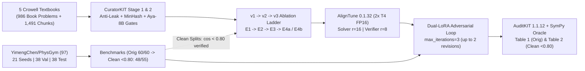

# Adversarial Physics Solver–Verifier

**Competition:** Lexsi AI Safety & Alignment Hackathon — Track 1, Problem Statement 8 (*Data-Scarce Domains*)  
**Author:** [`vital-ar`](https://github.com/vital-ar) · **Full Write-Up:** [`docs/HACKATHON_WRITEUP.md`](docs/HACKATHON_WRITEUP.md)  
**Base Student Model:** [`CohereLabs/tiny-aya-global`](https://huggingface.co/CohereLabs/tiny-aya-global) (`3.35B`, `cc-by-nc-4.0`)  
**Teacher / Curator Model:** [`CohereLabs/aya-expanse-8b`](https://huggingface.co/CohereLabs/aya-expanse-8b) (alias `CohereForAI/aya-expanse-8b`, `8.03B`, `cc-by-nc-4.0`)  
**Core Stack:** `CuratorKIT` (`0.1.22`) · `AlignTune` (`0.1.32`) · `AuditKIT` (`1.1.12`)

## Public Hugging Face Collections

* **Models Collection (17 public repos — base, teacher & 15 `v1/v2/v3` LoRA adapters):**  
  [Adversarial Physics Solver-Verifier — Models (Track 1)](https://huggingface.co/collections/vital-ar/adversarial-physics-solver-verifier-models-track-1-6af21ed6fe3d3d356ac11bc9)
* **Datasets & Traces Collection (17 public repos — 15 SFT tiers, `PhysGym`, & full eval/loop traces):**  
  [Adversarial Physics Solver-Verifier — Datasets & Traces](https://huggingface.co/collections/vital-ar/adversarial-physics-solver-verifier-datasets-and-traces-6af9bd217256661d47a74225)
* **Benchmarks, Traces & Calibration Reports Repo:**  
  [`vital-ar/adversarial-physics-eval-traces-benchmarks`](https://huggingface.co/datasets/vital-ar/adversarial-physics-eval-traces-benchmarks)

---

## 1. System Overview & Pipeline Architecture

The **Adversarial Physics Solver–Verifier** equips a single shared `CohereLabs/tiny-aya-global` (`3.35B`, FP16) backbone with two hot-swapped `AlignTune` LoRA adapters:

* **Model A — Solver (`r=16, alpha=24`):** Generates a 1–10 step symbolic physics derivation ending in `ANSWER: <value>`. When challenged, it re-solves **from a clean slate** conditioned only on self-contained physical constraints from the Verifier.
* **Model B — Verifier (`r=8, alpha=16`):** Audits Model A's normalized derivation without seeing ground-truth answers, emits a non-leaking physical directive, and concludes with `[[APPROVE]]` or `[[CHALLENGE]]`.



---

## 2. Headline Results (`v3` — Table 1 Original vs Table 2 Clean `< 0.80`)

Following an `all-MiniLM-L6-v2` semantic anti-leak audit (`cosine < 0.80` across all `v1`/`v2`/`v3` splits, archiving `1` / `27` / `17` overlapping evaluation items into [`excluded_leaked_eval_items_080.json`](results/audit_reports/excluded_leaked_eval_items_080.json)), we report **both** exact historical metrics (`n = 60` Val / Test) and deterministic clean-subset recalculations (`cos < 0.80`: `n = 48` Val / `n = 55` Test):

### Table 1: Original Evaluated Splits (`v3`, `n = 60` Val / `n = 60` Test)

| Exp | Val Acc (`n=60`) | Val Cur (`n=22`) | *p* vs `E0` | Test Acc (`n=60`) | Test Cur (`n=22`) | Sentinel (V / T) | Eq F1 (V / T) | Degen ↓ (V / T) |
| :--- | ---: | ---: | ---: | ---: | ---: | ---: | ---: | ---: |
| **`E0_v3`** | `0.00%` (0/60) | `0.00%` | — | `1.67%` (1/60) | `4.55%` | `95.0%` / `93.3%` | `0.2909` / `0.2854` | `31.7%` / `36.7%` |
| **`E1_v3`** | `5.00%` (3/60) | `13.64%` | `0.0890` | `1.67%` (1/60) | `4.55%` | `43.3%` / `46.7%` | `0.1773` / `0.1527` | `40.0%` / `33.3%` |
| **`E2_v3`** | `6.67%` (4/60) | `18.18%` | **`0.0290`** | **`5.00%` (3/60)** | **`13.64%`** | `90.0%` / `95.0%` | `0.2987` / `0.3064` | `10.0%` / `11.7%` |
| **`E3_v3`** | **`8.33%` (5/60)** | **`22.73%`** | **`0.0050`** | `3.33%` (2/60) | `9.09%` | `90.0%` / `90.0%` | **`0.3862`** / `0.3723` | `1.7%` / `1.7%` |
| **`E4a_v3`** | `5.00%` (3/60) | `13.64%` | `0.0990` | `3.33%` (2/60) | `9.09%` | `91.7%` / `95.0%` | `0.3788` / `0.3830` | `1.7%` / `1.7%` |
| **`E4b_v3`** | `6.67%` (4/60) | `18.18%` | **`0.0330`** | `3.33%` (2/60) | `9.09%` | **`100.0%` / `100.0%`** | `0.3830` / **`0.3911`** | **`0.0%` / `0.0%`** |

### Table 2: Leak-Free Recalculated Splits (`all-MiniLM-L6-v2` Cosine `< 0.80`: `n = 48` Val / `n = 55` Test)

| Exp | Val Clean (`n=48`) | Val Cur (`n=10`) | *p* vs `E0` | Test Clean (`n=55`) | Test Cur (`n=17`) | Sentinel (V / T) | Eq F1 (V / T) | Degen ↓ (V / T) |
| :--- | ---: | ---: | ---: | ---: | ---: | ---: | ---: | ---: |
| **`E0_v3`** | `0.00%` (0/48) | `0.00%` | — | `0.00%` (0/55) | `0.00%` | `93.8%` / `92.7%` | `0.2935` / `0.2850` | `35.4%` / `32.7%` |
| **`E1_v3`** | `2.08%` (1/48) | `10.00%` | `0.7160` | `1.82%` (1/55) | `5.88%` | `39.6%` / `45.5%` | `0.1592` / `0.1453` | `43.8%` / `34.6%` |
| **`E2_v3`** | **`4.17%` (2/48)** | **`20.00%`** | `0.2490` | **`3.64%` (2/55)** | **`11.76%`** | `87.5%` / `96.4%` | `0.2791` / `0.3013` | `8.3%` / `10.9%` |
| **`E3_v3`** | **`4.17%` (2/48)** | **`20.00%`** | `0.2490` | `1.82%` (1/55) | `5.88%` | `87.5%` / `89.1%` | `0.3544` / `0.3566` | `2.1%` / `1.8%` |
| **`E4a_v3`** | `2.08%` (1/48) | `10.00%` | `0.7160` | **`3.64%` (2/55)** | **`11.76%`** | `89.6%` / `94.6%` | `0.3559` / `0.3714` | `2.1%` / `1.8%` |
| **`E4b_v3`** | **`4.17%` (2/48)** | **`20.00%`** | `0.2490` | **`3.64%` (2/55)** | **`11.76%`** | **`100.0%` / `100.0%`** | **`0.3566` / `0.3774`** | **`0.0%` / `0.0%`** |

* **Key Clean-Split Takeaway (`0.00%` Zero-Shot → `4.17% / 3.64%`):** Once `cos >= 0.80` items are excluded, base `E0` scores **`0/48` (Val) and `0/55` (Test)**; `E4b_v3` ties peak clean accuracy (`20.00%` Val / `11.76%` Test curated) with **`100.0%`** sentinel compliance, **`0.0%`** token collapse, and highest Equation F1 (`0.3566` / `0.3774`).
* **Verifier Retraining Calibration:** Fixing a training-vs-inference prefix mismatch and retraining Epoch-7 rank-8 `E4b_v3` reduced false approvals from **`92.50%` → `12.98%` (Val Orig) / `12.96%` (Val Clean)** (`22.50%` Test Orig / `24.07%` Test Clean) and lifted Challenge F1 to **`91.94%` Orig / `92.61%` Clean** on Validation (`86.11%` Orig / `84.97%` Clean on Test).
* **SymPy-vs-`AlignTune` Grader Agreement (`n=600` pooled `v3`):** **`98.83%`** raw agreement, **Cohen's $\kappa$ = `0.8234`**.
* **Total Tracked Training Compute:** **`19.47` GPU-hours** (`70,096.72s`) across 15 LoRA runs (`v1`, `v2`, `v3`) on free Kaggle `2x T4`. Full Table 1 + Table 2 reports: [`experiment_comparison_v1_v2_v3.md`](results/comparison_tables/experiment_comparison_v1_v2_v3.md) and [`leak_and_calibration_summary.json`](results/audit_reports/leak_and_calibration_summary.json).

---

## 3. Repository Layout

* [`configs/`](configs) — YAML configurations for ingestion (`ingestion.yaml`, `book_ingestion.yaml`, `split_21_38_38.yaml`), `CuratorKIT` gating (`curatorkit_pipeline.yaml`), `AlignTune` training (`aligntune_training{,_v2,_v3}.yaml`), `AuditKIT` evaluation (`auditkit_benchmark.yaml`), and `v3` dual-LoRA loop inference (`orchestrator.yaml`).
* [`src/adversarial_physics/`](src/adversarial_physics) — Modular Python package (`data/ingestion`, `data/curation`, `data/generation`, `data/processing`, `training`, `orchestration`, `evaluation`, `agents`, `utils`).
* [`scripts/`](scripts) — End-to-end CLI runners (`01_ingest_and_split.py` → `04f_build_and_upload_v3.py`, `05_train_aligntune.py`, `06_eval_solver.py`, `validate_e4_loop.py`, `07_build_experiment_tables.py`, `09_leak_and_calibration_audit.py`).
* [`notebooks/`](notebooks) — Kaggle `2x T4` training & loop evaluation notebooks (`training-v3-e4s-e2.ipynb`, `training-v3-e3-e4v-e1.ipynb`, `retrain-v3-verifier-and-eval.ipynb`, `eval-v3-loop.ipynb`).
* [`data/splits/`](data/splits) — Leak-purged `< 0.80` MiniLM splits (`v1`: `38/37`, `v2`: `44/49`, `v3`: `48/55`) plus `21` PhysGym training seeds.
* [`results/`](results) — Raw per-problem JSON/JSONL traces, dual Table 1/Table 2 comparison reports, prefix-leak ablation, and audit reports.
* [`docs/`](docs) — [`HACKATHON_WRITEUP.md`](docs/HACKATHON_WRITEUP.md) and [`PROJECT_BLUEPRINT.md`](docs/PROJECT_BLUEPRINT.md).
* [`tests/`](tests) — Offline CPU unit & audit tests covering curation gates, `< 0.80` anti-leak checks, prompt normalization, loop orchestration, dual-table recalculation, and Cohen's $\kappa$ audits.

---

## 4. Environment Setup & Reproducibility

Python `3.11+` is recommended (`HF_TOKEN` only needed when pushing new models/datasets or accessing gated resources).

### Local CPU Installation & Offline Verification (`Windows` / `Linux`)

```powershell
py -3.11 -m venv venv
.\venv\Scripts\Activate.ps1         # Linux/macOS: source venv/bin/activate
python -m pip install --upgrade pip
python -m pip install -r requirements/local.txt
python -m pip install -e .

# Run full test suite, regenerate dual Table 1 + Table 2 reports, and run <0.80 leak & kappa audit:
python -m pytest -q
python scripts/07_build_experiment_tables.py
python scripts/09_leak_and_calibration_audit.py
```

### Kaggle `2x T4` GPU Reproduction (`v3` Pipeline)

```bash
python -m pip install -r requirements/kaggle.txt && python -m pip install -e .

# 1. Stage 1 & 2 Data Splits & SFT Export (rebuild locally from curated intermediates; --no-upload skips HF push)
python scripts/01_ingest_and_split.py --config configs/data/ingestion.yaml
python scripts/04f_build_and_upload_v3.py --no-upload

# 2. Train v3 LoRA Adapters via AlignTune (pulls datasets automatically from HF Hub if absent locally)
python scripts/05_train_aligntune.py --dataset solver_e1_manual_det     --config configs/training/aligntune_training_v3.yaml --output-dir models/adapters/solver_e1_manual_det_v3_lora
python scripts/05_train_aligntune.py --dataset solver_e2_curatorkit_nollm --config configs/training/aligntune_training_v3.yaml --output-dir models/adapters/solver_e2_curatorkit_nollm_v3_lora
python scripts/05_train_aligntune.py --dataset solver_e3_canonical_llm  --config configs/training/aligntune_training_v3.yaml --output-dir models/adapters/solver_e3_canonical_llm_v3_lora
python scripts/05_train_aligntune.py --dataset solver_e4_adversarial    --config configs/training/aligntune_training_v3.yaml --output-dir models/adapters/solver_e4_adversarial_v3_lora
python scripts/05_train_aligntune.py --dataset verifier_e4_curated      --config configs/training/aligntune_training_v3.yaml --output-dir models/adapters/verifier_e4_curated_v3_lora

# 3. Single-Turn Solver Evaluation (E0..E4a) on Clean (<0.80 cosine) v3 Splits (n=48 Val / n=55 Test)
python scripts/06_eval_solver.py --experiment E3_v3 --base-model CohereLabs/tiny-aya-global --adapter-dir vital-ar/adversarial-physics-solver-e3-canonical-llm-v3-lora --validation-path data/splits/validation_v3.jsonl --test-path data/splits/test_v3.jsonl --prompt-mode raw --output-dir results/eval_e3_v3

# 4. Multi-Turn Adversarial Loop Evaluation (uses v3 defaults + verifier_max_new_tokens=384 from configs/inference/orchestrator.yaml)
python scripts/validate_e4_loop.py --validation-path data/splits/validation_v3.jsonl --max-iterations 3 --output-dir results/eval_e4_loop_v3_val
python scripts/validate_e4_loop.py --validation-path data/splits/test_v3.jsonl       --max-iterations 3 --output-dir results/eval_e4_loop_v3_test
```

For planned extensions (`E3_v3 Solver + E4b_v3 Verifier` cross-pairing, `max_iterations > 3` on PhysGym problems, and DPO/GRPO Verifier alignment), see Section 9 of [`docs/HACKATHON_WRITEUP.md`](docs/HACKATHON_WRITEUP.md).
