# Adversarial Physics Solver–Verifier: Teaching a 3.35B Model University Physics via CuratorKIT Ablations & Anti-Leak Self-Correction

> **One-line claim:** Progressive `CuratorKIT` filtering, structured reasoning normalization, and anti-leak dual-LoRA Solver–Verifier post-training on `CohereLabs/tiny-aya-global` lift university physics accuracy from **0.00% → 8.33%** (**22.73%** curated, *p* = 0.0050) on full `n=60` splits — and from **0.00% (0/48 & 0/55) → 4.17% / 3.64%** (**20.00% / 11.76%** curated) on strict `all-MiniLM-L6-v2` cosine `< 0.80` leak-free splits — while cutting repetition collapse from **31.67–36.67% → 0.00%** and turning an over-approving critic (**92.50% false approvals**) into a calibrated verifier (**91.94% / 92.61% Clean Val Challenge F1**, **100.00%** sentinel compliance).

---

## Submission Metadata & Collections

* **Competition Track & Problem Statements Covered:**
  * **Track 1 (`[T1]`) — Low-Resource / Data-Scarce Fine-Tuning & Reasoning**
    * **Problem Statement 8:** *Data-Scarce Domains* (university-level multi-step symbolic physics from only `21` benchmark training seeds augmented with open-source textbooks and synthetic derivations)
* **Author / Teammates:** `@vital-ar` (Solo Entrant; add team handles before final form submission) · **Registered Email:** `[fill-registered-email@example.com before portal submit]`
* **GitHub Repository:** [vital-ar/adversarial_physics_problems_solver](https://github.com/vital-ar/adversarial_physics_problems_solver)
* **Hugging Face Model Collection (Public, Un-gated — 17 models):** [Adversarial Physics Solver-Verifier — Models (Track 1)](https://huggingface.co/collections/vital-ar/adversarial-physics-solver-verifier-models-track-1-6af21ed6fe3d3d356ac11bc9)
* **Hugging Face Dataset Collection (Public, Un-gated — 17 datasets & traces):** [Adversarial Physics Solver-Verifier — Datasets & Traces](https://huggingface.co/collections/vital-ar/adversarial-physics-solver-verifier-datasets-and-traces-6af9bd217256661d47a74225)
* **Evaluation Benchmarks & Full Multi-Turn Loop Traces Repo:** [vital-ar/adversarial-physics-eval-traces-benchmarks](https://huggingface.co/datasets/vital-ar/adversarial-physics-eval-traces-benchmarks)

> **Content Warning:** None. All datasets, prompts, outputs, and traces in this project contain strictly educational university physics problems and mathematical derivations across mechanics, electromagnetism, thermodynamics, optics, relativity, and modern physics.

---

## Abstract

University-level symbolic physics is an archetypal data-scarce reasoning domain: benchmarks like PhysGym contain fewer than 100 problems, and naive fine-tuning on small textbook dumps teaches small language models brittle answer shortcuts rather than coherent derivations. We investigate whether Lexsi AI's end-to-end post-training stack (`CuratorKIT`, `AlignTune`, and `AuditKIT`) can transform a compact 3.35B foundation model (`CohereLabs/tiny-aya-global`) into a collaborative two-adapter **Solver–Verifier** physics reasoner on free `2x NVIDIA T4` GPUs (`19.47` total training GPU-hours across three experimental iterations).

Starting from just `21` PhysGym training seeds and five open-licensed Benjamin Crowell textbooks (`986` initial book problems), we isolate each curation stage through a progressive ablation ladder (`E0` zero-shot → `E1` manual deterministic rules → `E2` `CuratorKIT` deterministic deduplication + SymPy-verified chapter-grounded synthetic problems → `E3` `CuratorKIT` LLM quality gates via `CohereLabs/aya-expanse-8b` → `E4a` multi-turn hint-conditioned Solver → `E4b` iterative Solver–Verifier critique loop). To guarantee strict out-of-sample integrity, we audit every split against all training rows using exact ID/text checks, 5-shingle Jaccard (`< 0.75`), and dense `all-MiniLM-L6-v2` semantic similarity (`cosine < 0.80`), purging `17` overlapping `v3` items (`v2`: `27`, `v1`: `1`) and reporting both exact historical splits (`n=60/60`) and clean recalculated subsets (`n=48` Val / `n=55` Test).

Across `v1 → v2 → v3`, stabilizing LoRA learning rates (`2e-4 → 1e-4`), standardizing derivation step structure, removing terse shortcut keys, and fixing a Verifier prompt-prefix mismatch yields consistent gains: on `v3` Validation/Test (`n=60`), accuracy rises from **0.00% → 8.33%** (`E3`, **22.73%** curated, *p* = 0.0050) and **1.67% → 5.00%** (`E2`); under strict `cos < 0.80` recalculation (`n=48/55`), zero-shot `E0` scores **0.00%** on both splits while **`E4b_v3`** matches peak curated accuracy (**20.00%** Val / **11.76%** Test) with **100.00%** sentinel compliance, **0.00%** repetition collapse, and highest clean equation token F1 (**0.3566 / 0.3774**). Retraining the rank-8 Verifier eliminates a **92.50%** false-approval failure mode, restoring **91.94% / 92.61%** (Orig/Clean Val) and **86.11% / 84.97%** (Orig/Clean Test) Challenge F1, alongside **98.83%** SymPy-vs-`AlignTune` grader agreement ($\kappa$ = **0.8234**).

---

## Headline Metrics & One-Minute Judge Summary

* **Headline Before → After (`CohereLabs/tiny-aya-global`, Shared Base, Orig `n=60/60` vs Clean `cos < 0.80`: `n=48/55`):**
  * **Validation Physics Accuracy:** Orig `0.00% (0/60)` [`E0`] → **`8.33% (5/60)`** [`E3_v3`, *p* = `0.0050`; **`22.73%`** cur] | Clean `0.00% (0/48)` [`E0`] → **`4.17% (2/48)`** [`E2/E3/E4b_v3`; **`20.00% (2/10)`** cur]
  * **Test Physics Accuracy:** Orig `1.67% (1/60)` [`E0`] → **`5.00% (3/60)`** [`E2_v3`; **`13.64%`** cur] | Clean `0.00% (0/55)` [`E0`] → **`3.64% (2/55)`** [`E2/E4a/E4b_v3`; **`11.76% (2/17)`** cur]
  * **Equation Token F1:** Orig `0.2909 / 0.2854` [`E0`] → **`0.3862`** [`E3` val] / **`0.3911`** [`E4b` test] | Clean `0.2935 / 0.2850` [`E0`] → **`0.3566 / 0.3774`** [`E4b` val/test]
  * **Repetition Collapse (`degenerate_rate`):** Orig `31.67% / 36.67%` [`E0`] → **`0.00%`** [`E4b_v3` val & test] (Clean: `35.42% / 32.73%` → **`0.00%`**)
  * **`ANSWER:` Sentinel Compliance:** `43.33% / 46.67%` [`E1_v3`] → **`100.00%`** [`E4b_v3` Orig & Clean]
  * **Verifier Retrain Calibration:** False approvals dropped **`92.50%` → `12.98% / 12.96%`** (Val Orig/Clean) and `22.50% / 24.07%` (Test Orig/Clean); Challenge F1 rose **`13.95%` → `91.94% / 92.61%`** (Val Orig/Clean)
* **Base Model + Method in One Line:** Single shared `CohereLabs/tiny-aya-global` (`3.35B`, FP16) backbone hot-swapping two `AlignTune` LoRA adapters — **Model A Solver (`r=16, \alpha=24`)** and **Model B Verifier (`r=8, \alpha=16`)** — curated end-to-end by `CuratorKIT` + `CohereLabs/aya-expanse-8b` and audited with `AuditKIT`.

> **For Judges — One Minute Overview**
> 1. **Scarcity Problem:** `PhysGym` has only `97` problems total. Training a 3.35B model on raw uncurated textbook exercises (`E1`) produces **40–44% repetition collapse** and **40–47% sentinel compliance**.
> 2. **What Changed (`CuratorKIT` + `AlignTune`):** Enforcing `all-MiniLM-L6-v2` cosine `< 0.80` split hygiene, chapter-scoped subtopic synthesis (`SymPy` verified), uniform 1–10 step normalization, and a two-adapter collaborative loop producing self-contained physical directives (`[[CHALLENGE]]` / `[[APPROVE]]`).
> 3. **Honest Engineering Rigor:** When initial `v3` Verifier approved `92.5%` of wrong derivations from a prompt-prefix mismatch, we fixed it and report **both** the failed ablation (`results/ablations/eval_e4_loop_v3_prefix_leaked/`) and calibrated loop (`91.94% / 92.61%` Challenge F1). Likewise, when a strict post-hoc `cos >= 0.80` audit flagged `17` overlapping `v3` eval prompts, we purged all splits, updated Hugging Face collections, and published **both** Table 1 (Original) and Table 2 (Clean `< 0.80` Recalculated) transparently.

---

## 1. Problem Statement & Approach

### Why This Problem / Real Use Case
Automated physics tutoring and scientific verification require models that do more than memorize surface trivia: every sign error, dropped rotational inertia term, or unit inconsistency breaks downstream engineering. Yet high-grade university physics benchmarks contain only tens to hundreds of curated problems (e.g., `PhysGym` has `97` items), far too small to fine-tune an LLM safely without severe overfitting or memorization. Open-access physics textbooks offer exercises and instructor manuals, but raw PDF extractions are plagued by missing diagram references, multi-part dependencies, terse one-line answer keys, and near-duplicate variations that leak across evaluation splits.

Solving this in a genuine **data-scarce setting on commodity hardware (`2x NVIDIA T4`, 16 GB VRAM)** mirrors real academic and industrial deployments where proprietary frontier APIs cannot be fine-tuned or hosted locally, and where small 3B-class models must be both **curated into high-signal reasoning data** and **equipped with an external critic** capable of catching physical errors at inference time.

### Research Questions & Pre-Registered Hypotheses
Following [`docs/PROJECT_BLUEPRINT.md`](../docs/PROJECT_BLUEPRINT.md), we tested four hypotheses across our progressive ladder:
* **H1 (Deterministic Hygiene vs Raw Extraction, `E2` vs `E1`):** Replacing brittle manual PDF heuristics (`E1`) with `CuratorKIT` embedding anti-leakage, MinHash deduplication, diversity gating, and SymPy-verified synthetic problems (`E2`) will reduce decoding collapse and improve formatting compliance and out-of-sample accuracy without touching LLM curation judges.
* **H2 (Teacher Normalization & Quality Gates, `E3` vs `E2`):** Adding `CuratorKIT` LLM gates (`HallucinationGate`, `RewardGate`, `RewardRefiner`) backed by `CohereLabs/aya-expanse-8b` and normalizing derivations to coherent 1–10 step chains (`E3`) will substantially increase step structure, equation F1, and validation accuracy.
* **H3 (Multi-Turn Hint Conditioning & Self-Correction, `E4a/E4b` vs `E3`):** Training a companion rank-8 Verifier (`E4b`) on counterfactual error taxonomies plus real `tiny-aya-global` mistakes — and re-prompting the Solver from a **clean slate with self-contained physical directives** — will convert wrong Turn-0 attempts into correct derivations (`converted > 0`) without catastrophic regressions (`regression_rate` small).
* **H4 (Format & Anti-Leak Calibration Across Iterations `v1 → v2 → v3`):** Eliminating short-cut `<220`-char targets, shifted `[[APPROVE]]` rows, and prompt-prefix drift between SFT training and `loop.py` inference is necessary for calibrated Verifier F1.

### Related Work
* **PhysGym:** Chen et al., *YimengChen/PhysGym* — compact, multi-domain university physics benchmark (`97` problems across 6 domains, `CC0-1.0`) emphasizing algebraic and symbolic derivations.
* **Parameter-Efficient Adaptation (LoRA):** Hu et al. (*LoRA: Low-Rank Adaptation of Large Language Models*, ICLR 2022) — enabling dual task-specialized adapters (`r=16` Solver, `r=8` Verifier) to hot-swap on a single frozen `3.35B` backbone within 16 GB T4 VRAM.
* **External Critique & Self-Correction Limits:** Huang et al. (*Large Language Models Cannot Self-Correct Reasoning Yet*, ICLR 2024) & Gou et al. (*CRITIC: Large Language Models Can Self-Correct with Tool-Interactive Critiquing*) — showing intrinsic self-correction fails without an external critic or distinct verifier training distribution, motivating our decoupled Solver/Verifier adapters with clean-slate hint accumulation.

---

## 2. Hackathon Repos Used & Pipeline Architecture

### Kits Used (`CuratorKIT`, `AlignTune`, `AuditKIT`)
* **`CuratorKIT` (`curatorkit==0.1.22`):**
  * Used in [`src/adversarial_physics/data/curation/curatorkit_stage1.py`](../src/adversarial_physics/data/curation/curatorkit_stage1.py), [`subtopic_extractor.py`](../src/adversarial_physics/data/ingestion/subtopic_extractor.py), [`04c_curatorkit_dedup_trajectories.py`](../scripts/04c_curatorkit_dedup_trajectories.py), and [`dataset_exporter.py`](../src/adversarial_physics/data/curation/dataset_exporter.py).
  * Features used: `TextCleaner`, `EmbeddingDeduplicator` (FAISS + `sentence-transformers/all-MiniLM-L6-v2` at `threshold=0.80`/`0.85` for anti-leakage against held-out splits), `ExactDeduplicator`, `MinHashDeduplicator` (`0.85`), `PostHocRetriever` (chapter-scoped subtopic retrieval), `SchemaGate`, `DiversityGate` (`coverage_field="domain"`), `HallucinationGate` (`0.85`), `RewardGate` (`0.82` with custom 6-dimension `STAGE1_PHYSICS_RUBRIC_PROMPT`, `on_judge_error="reject"`), `RewardRefiner`, and `ProvenanceManifest` / `build_provenance` (`lexsi.provenance/1`).
* **`AlignTune` (`aligntune==0.1.32`):**
  * Used in [`src/adversarial_physics/training/run_aligntune.py`](../src/adversarial_physics/training/run_aligntune.py), [`scripts/05_train_aligntune.py`](../scripts/05_train_aligntune.py), and [`src/adversarial_physics/evaluation/auditkit_bridge.py`](../src/adversarial_physics/evaluation/auditkit_bridge.py).
  * Features used: `create_sft_trainer` (mandatory `trl` backend), `task_type="instruction_following"`, completion-only NLL loss (`completion_only_loss=true`, `label_smoothing=0.0`), PEFT LoRA config injection (`q/k/v/o/gate/up/down_proj`), HF Hub dataset loading/pushing, plus `aligntune.eval` metrics (`AuditReport`, `BleuMetric`, `RougeMetric`, `VerbosityDelta`) and `aligntune.utils.math_grading.grade_math_answer`.
* **`AuditKIT` (`auditkit==1.1.12` on Kaggle GPU evaluation + offline audit suite):**
  * Used in [`src/adversarial_physics/evaluation/auditkit_bridge.py`](../src/adversarial_physics/evaluation/auditkit_bridge.py), [`comparison_tables.py`](../src/adversarial_physics/evaluation/comparison_tables.py), and [`calibration_audit.py`](../src/adversarial_physics/evaluation/calibration_audit.py).
  * Features used: 22-metric physics evaluation suite (symbolic SymPy + ±1.5% / ±5.0% numeric + SI unit consistency + Alignment hygiene `repetition_ratio`, `degenerate_rate`, `meta_leakage_rate`, `reward_hacking`), Verifier Suite 4 safety diagnostics (`false_approval_rate`, `directive_self_containment`), paired bootstrap 95% CIs & permutation tests, McNemar exact tests, SHA-256 eval fingerprinting, and Cohen's $\kappa$ calibration.
* *(Not used in Track 1: `AgentTune`, `SafeTune`, `CircuitKIT` — out of scope for pure single/dual-LoRA SFT on symbolic physics derivations.)*

### How the Repos Connect

```mermaid
flowchart LR
    PG["YimengChen/PhysGym (97)<br/>Split: 21 Train / 38 Val / 38 Test"] --> PG_S["Clean Splits (cos < 0.80)<br/>v2: 44/49 | v3: 48/55 (Orig 60/60)"]
    BK["5 Crowell Textbooks<br/>(986 Book Problems + 1,491 Chunks)"] --> CK1["CuratorKIT Stage 1<br/>TextCleaner + Embedding Anti-Leak<br/>MinHash + Schema + Diversity"]
    CK1 -->|No LLM Gates| E1E2["E1 (452) -> E2 (608)<br/>+32 SymPy Synthetic"]
    E1E2 -->|Aya-Expanse-8B + Hallucination/RewardGate| E3["E3 Canonical Pool (622)<br/>Uniform 1-10 Steps"]
    E3 -->|Sol2 + Tiny-Aya Failures + Directives| E4DS["E4a Solver (758)<br/>E4b Verifier (720)"]
    PG_S -.->|"Leak Check: 0 overlaps, max cos 0.7985"| E4DS
    E1E2 --> AT["AlignTune 0.1.32<br/>create_sft_trainer (2x T4 FP16)<br/>Solver r=16 | Verifier r=8"]
    E3 --> AT
    E4DS --> AT
    AT -->|Hot-Swapped Dual LoRAs on tiny-aya-global| LOOP["Adversarial Loop (max_iters=3)<br/>Clean-Slate Re-Solve + [[APPROVE]]/[[CHALLENGE]]"]
    PG_S --> LOOP
    LOOP --> AK["AuditKIT 1.1.12 + SymPy Oracle<br/>22 Metrics, Bootstrap CIs, Cohen's kappa"]
```



---

## 3. Models & Licenses

| Role | Model ID | Params (Verified Safetensors) | Precision / Config | License | Rationale |
| :--- | :--- | :--- | :--- | :--- | :--- |
| **Base Student Model** | [`CohereLabs/tiny-aya-global`](https://huggingface.co/CohereLabs/tiny-aya-global) | `3,349,227,520` (~3.35B) | `fp16` base (`device_map="balanced"`, `gradient_checkpointing=true`), frozen embeddings | `cc-by-nc-4.0` | Compact Aya-family student capable of Dual-LoRA hot-swapping on `2x T4` (16 GB) while struggling zero-shot (`0/60` Val, `31–37%` repetition collapse), creating clear SFT signal |
| **Teacher & Curator / Judge Model** | [`CohereLabs/aya-expanse-8b`](https://huggingface.co/CohereLabs/aya-expanse-8b) (alias `CohereForAI/aya-expanse-8b`) | `8,028,033,024` (~8.03B) | 4-bit NF4 on T4 / HF GPU inference for subtopic synthesis, canonicalization, counterfactual errors & directives | `cc-by-nc-4.0` | Shares Aya mathematical notation & chat/instruction cadence with `tiny-aya-global` while large enough (`8.03B`) to normalize steps and pass SymPy verification without API dependency (`32B` supported via `--backend` override) |
| **Solver LoRA Adapters (`E1`, `E2`, `E3`, `E4a` × `v1/v2/v3`)** | [`vital-ar/adversarial-physics-solver-*`](https://huggingface.co/collections/vital-ar/adversarial-physics-solver-verifier-models-track-1-6af21ed6fe3d3d356ac11bc9) | LoRA `r=16`, `alpha=24` (`v3`) / `32` (`v1/v2`) on 7 linear projections | `q/k/v/o/gate/up/down_proj`, `dropout=0.08` (`v3`) | `cc-by-sa-4.0` / adapter over `cc-by-nc-4.0` base | Full capacity across all 7 linear layers for 6-domain symbolic physics derivations |
| **Verifier LoRA Adapter (`E4b` × `v1/v2/v3`)** | [`vital-ar/adversarial-physics-verifier-e4-curated-v3-lora`](https://huggingface.co/vital-ar/adversarial-physics-verifier-e4-curated-v3-lora) | LoRA `r=8`, `alpha=16` (`v3` bottleneck) | `lr=1e-4`, `dropout=0.10`, `7` epochs, `10%` stratified val | `cc-by-sa-4.0` / adapter over `cc-by-nc-4.0` base | Low-rank `r=8` bottleneck curbs derivation memorization and sharpens `[[APPROVE]]` vs `[[CHALLENGE]]` calibration |
| **Closed-Model Baseline** | *None evaluated* | — | — | — | Not run; evaluation stayed strictly within open-weight Aya models (`E0` `tiny-aya-global` baseline + `aya-expanse-8b` teacher) |

---

## 4. Datasets, Benchmarks & Licenses

### Sources of Data & Progressive Ablation Counts (`v1 → v2 → v3`)

All training examples are in **English (`en`)** with standard LaTeX equations. External sources are **[`YimengChen/PhysGym`](https://huggingface.co/datasets/YimengChen/PhysGym)** (`CC0-1.0`, pinned to commit `8e122553897e77495dc2690f16d8055aea1655d7`, `97` problems across 6 domains) and five open textbooks by **Benjamin Crowell** (`Light and Matter` / `Simple Nature` / `Conceptual Physics` / `Mechanics` / `Fields and Circuits` / `Modern Physics` + `solns-all.pdf`, **`CC BY-SA 4.0`**). Synthetic derivations, counterfactual flaws, and directives generated via `aya-expanse-8b` are released under **`CC BY-SA 4.0`**.

| Dataset Tier | HF Dataset Repo (`-v3` suffix shown; `v1`/`v2` also published) | `v1` Train | `v2` Train | `v3` Train | Composition (`v3`) | License |
| :--- | :--- | ---: | ---: | ---: | :--- | :--- |
| **`E1` (Manual Rules)** | `vital-ar/physics-solver-e1-manual-rules-v3` | 1,076 | 907 | **452** | `446` Crowell + `6` PhysGym seeds (terse `<220` char one-liners purged in `v3`) | `cc-by-sa-4.0` |
| **`E2` (`CuratorKIT` No-LLM + Synth)** | `vital-ar/physics-solver-e2-curatorkit-nollm-v3` | 728 | 865 | **608** | `570` Crowell + `32` subtopic-grounded SymPy synthetic + `6` PhysGym seeds | `cc-by-sa-4.0` |
| **`E3` (`CuratorKIT` LLM Canonical)** | `vital-ar/physics-solver-e3-canonical-llm-v3` | 681 | 622 | **622** | `585` LLM-curated Crowell + `31` synthetic + `6` PhysGym seeds (`61.4%` Mech, `19.3%` E&M, `8.4%` Mod, `5.0%` Rel, `3.1%` Opt, `2.9%` Thermo) | `cc-by-sa-4.0` |
| **`E4a` (Adversarial Solver SFT)** | `vital-ar/physics-solver-e4-adversarial-v3` | 1,444 | 826 | **758** | `622` Turn-0 Sol1 + `1` minority Sol2 + `63` Turn-1 (1 hint) + `72` Turn-2 (2 hints), repetition capped `<= 2x` | `cc-by-sa-4.0` |
| **`E4b` (Adversarial Verifier SFT)** | `vital-ar/physics-verifier-e4-curated-v3` | 1,511 | 848 | **720** | `108` balanced `[[APPROVE]]` (`18` per domain) + `612` `[[CHALLENGE]]` (`558` synthetic `aya-8b` + `54` real `tiny-aya-global`) | `cc-by-sa-4.0` |

### Train / Validation / Test Splits & Verified Semantic Leak Check (`cos < 0.80`)
* **`v1` Splits (`validation.jsonl` / `test.jsonl`):** Domain-stratified PhysGym split (`21` Train Seeds, **`38` Orig Val**, **`38` Orig Test** → **`38` Val / `37` Test** clean after purging `physgym_0204` at `cos = 0.8200` vs `physgym_0649`, leaving `max_cos = 0.6456`).
* **`v2` & `v3` Historical Splits (`n=60` Val / `n=60` Test):** **`38` PhysGym Olympiad problems** (`CC0-1.0`) + **`22` held-out Crowell textbook problems** (`CC BY-SA 4.0`). Domain mix per 60-problem split: Validation (`23` Mech, `15` E&M, `8` Mod, `5` Opt, `6` Thermo, `3` Rel); Test (`23` Mech, `17` E&M, `6` Mod, `5` Opt, `6` Thermo, `3` Rel).
* **Mandatory Dense Embedding Anti-Leakage Boundary (`all-MiniLM-L6-v2` cosine `< 0.80`):** Auditing all `data/sft*` training splits against every evaluation prompt (stripping multi-turn revision/proposed-solution suffixes) caught `1` (`v1`), `27` (`v2`: `16` val / `11` test, `max_cos = 0.9758`), and `17` (`v3`: `12` val / `5` test, `max_cos = 0.9758`) semantically overlapping Crowell/PhysGym prompts. All excluded raw rows + nearest training matches are archived in [`excluded_leaked_eval_items_080.json`](../results/audit_reports/excluded_leaked_eval_items_080.json), and clean splits (`v2`: `44/49`; `v3`: **`48` Val / `55` Test**, max `cos = 0.7985`) were pushed to `data/splits/` and HF Hub.
* **Post-Filter Verification (`scripts/09_leak_and_calibration_audit.py` → [`leak_and_calibration_summary.json`](../results/audit_reports/leak_and_calibration_summary.json)):** **`leak_free = true`**, **`id_overlap_count = 0`**, **`exact_normalized_text_overlap_count = 0`**, **`near_duplicate_pair_count = 0`** (`5`-shingle `0.75`), and **`0` MiniLM pairs `>= 0.80`** across all `v1` (`n=75`), `v2` (`n=93`), and `v3` (`n=103`) splits!

### `CuratorKIT` Filtering Funnel (Before → After)
1. **Raw Literature + Seed Pool:** `986` Crowell chapter problems + `21` PhysGym seeds (`15` accepted, `6` rejected for `>450` problem or `>1200` solution tokens) → `1,506` candidate subproblems after multipart splitting.
2. **Deterministic Hygiene (`Schema` & Diagram Rejection):** Rejected `338` diagram-dependent statements, `30` diagram-dependent solutions, `49` external cross-references, `18` too-short items, `3` unsplit multiparts → **`1,068`** candidates passed.
3. **`CuratorKIT` Anti-Leak & Deduplication (`EmbeddingDeduplicator` `0.80` + `MinHashDeduplicator`):** Purged `276` within-pool duplicates and `0` held-out leaks → `792` unique candidates; Stage 1 `SchemaGate` (`535` pass / `272` fail) and `DiversityGate` (`466` pass / `69` fail) formed the canonical base before `1,491` deduped subtopic chunks (`285` removed from `1,776` raw chunks) enabled chapter-scoped synthetic augmentation in `E2`.
4. **`v3` Export Integrity Gates (`04f_build_and_upload_v3.py`):** Applied `TextCleaner`, `SchemaGate`, `ExactDeduplicator`, and `AnswerSentinelGate` cleanly:
   * `E1_v3`: `498` → `452` (`46` exact duplicates removed)
   * `E2_v3`: `857` → `617` (`240` duplicates removed) → **`608`** (`9` non-symbolic/truncated `ANSWER:` rejected)
   * `E3_v3`: `642` → **`622`** (`20` rejected by `AnswerSentinelGate`)
   * `E4a_v3`: `783` → **`758`** (`25` rejected by `AnswerSentinelGate`)
   * `E4b_v3`: `720` → **`720`** (`0` duplicates, `0` invalid directives, `33` shifted `[[APPROVE]]` rows from `v2` purged prior to export).

### Safety & General Capability Benchmarks Monitored
* **General Capability & Domain-Stratified Tiers (`T1` focus):** Evaluated uniformly on both the **Curated In-Domain tier (`n=22`)** and the out-of-distribution **PhysGym Olympiad tier (`n=38`)** inside the `60`-problem Validation and `60`-problem Test splits.
* **Hygiene / What Should Not Get Worse (Stability Guardrails):** Continuous `AuditKIT` tracking of `degenerate_rate` (token loop collapse, lower is better), `repetition_ratio`, `meta_leakage_rate` (prompt/sentinel leakage inside final answers, target `0.00%`), `refusal_collapse`, and loop `regression_rate` (% of correct Turn-0 solutions ruined during Verifier revision).

---

## 5. Metrics & Grader / Verifier Calibration

### Evaluation Metric Suite (`AuditKIT` + `AlignTune` + `SymPy`)
| Metric | Definition | Direction | Role |
| :--- | :--- | :--- | :--- |
| **`accuracy` (Final Answer Accuracy)** | Strict SymPy symbolic simplification (`simplify(pred - ref) == 0`), exact normalized string, or `±1.5%` numeric tolerance + SI check | **Higher ↑** | Primary headline capability metric |
| **`curated_accuracy` / `physgym_accuracy`** | Tier-stratified accuracy on in-domain `22` problems vs out-of-distribution `38` PhysGym Olympiad problems | **Higher ↑** | Isolates in-domain transfer vs Olympiad difficulty |
| **`sentinel_rate`** | Share of responses emitting a parseable final `ANSWER:` line | **Higher ↑** | Structured reasoning & deployment contract |
| **`physics_equation_token_f1`** | F1 overlap over mathematical/physical symbol & operator tokens vs reference derivation | **Higher ↑** | Measures symbolic derivation fidelity even on partial credit |
| **`rouge1_f1` / `rougeL_f1`** | Lexical derivation similarity via `aligntune.eval.metrics.RougeMetric` | **Higher ↑** | Structural alignment to canonical 1–10 step solutions |
| **`degenerate_rate` & `repetition_ratio`** | Share of outputs exhibiting `>=8` consecutive repeated tokens or `>=5` repeated n-grams (safety/hygiene check) | **Lower ↓** | Guards against small-LM decoding collapse |
| **`meta_leakage_rate`** | Presence of `[[CHALLENGE]]`/`[[APPROVE]]`, chat tokens, or hint boilerplate inside Solver output | **Lower ↓** | Prevents cross-agent prompt leakage |
| **`verifier_challenge_f1` / `false_approval_rate`** | F1 of identifying wrong Solver turns (`[[CHALLENGE]]`) and critical rate of wrongly approving wrong derivations | **F1 ↑ / FA ↓** | Safety & usefulness of Model B Verifier |
| **`directive_self_containment` / `regression_rate`** | Directives with `0` target answer leaks or forbidden `"above"`/`"step N"` refs; share of Turn-0 correct answers broken | **SC ↑ / Reg ↓** | Ensures clean-slate multi-turn revision safety |

### Checking the Automatic Judges (Cohen's $\kappa$ Audits)
1. **Primary SymPy + Numeric Oracle vs `AlignTune` `grade_math_answer` (`n = 600` pooled `v3` `E0–E4a` Val + Test evaluations):**
   * Observed raw agreement = **`98.83%`** (`17` both pass, `576` both fail, `7` caught by SymPy physics equivalence missed by general math grader, `0` false positives by SymPy).
   * Expected chance agreement = `0.9339` → **Cohen's $\kappa$ = `0.8234`** (substantial-to-near-perfect inter-grader reliability).
2. **Trained Model B Verifier (`E4b_v3`) vs Oracle Verdict:**
   * *Original `n=60+60` (`266` reviews, `261` valid sentinels):* Pooled valid accuracy = **`80.84%`** (`84.17%` Val / `74.02%` Test overall), Challenge Precision = **`97.18%`**, Recall = **`82.47%`**, **Challenge F1 = `0.8922`** (`0.9194` Val / `0.8611` Test).
   * *Clean `cos < 0.80` Subset (`n=48+55`, `228` reviews, `223` valid sentinels):* Pooled valid accuracy = **`80.27%`** (**`84.96%`** Val / **`72.17%`** Test overall), Challenge Precision = **`97.78%`** (`176 / 180`), Recall = **`81.48%`**, **Challenge F1 = `0.8889`** (**`0.9261`** Val / **`0.8497`** Test).
   * *Note on $\kappa$ (`0.0698` Clean pooled / `0.1729` Clean Val):* High Turn-0 error base rate (`~96%` wrong turns → expected agreement `78.79%`) compresses chance-corrected $\kappa$, pinpointing remaining false approvals (`12.96%` Clean Val / `24.07%` Clean Test) and false challenges as the primary RL/DPO target.

---

## 6. Method, Hyperparameters & Iterative Evolution (`v1 → v2 → v3`)

Every adapter was fine-tuned using `aligntune.create_sft_trainer` (`backend="trl"`, `task_type="instruction_following"`, `completion_only_loss=true`, `label_smoothing=0.0`, `optimizer="paged_adamw_8bit"`, `lr_scheduler_type="cosine_with_restarts"`, `warmup_ratio=0.10`, `max_seq_length=2048`, `effective_batch_size=16`, `per_device_batch_size=1`, `gradient_accumulation_steps=16`, `seed=42`) on `2x NVIDIA T4` GPUs (`device_map="balanced"`, `max_memory={0: "2.2GiB", 1: "13GiB"}`).

| Iteration | Hyperparameters (`configs/training/aligntune_training*.yaml`) | Key Methodological & Data Fixes |
| :--- | :--- | :--- |
| **`v1` (Diagnostic)** | `epochs=10`, `solver_lr=2.0e-4`, `verifier_lr=1.5e-4`, `lora_r=16`, `alpha=32`, `dropout=0.05`, `weight_decay=0.01`, `eval_split="validation"` (38) | Initial end-to-end pipeline; suffered severe overfitting at `2e-4` LR, multi-part `<200`-char answer-only textbook keys, and chat-template eval mismatches |
| **`v2` (Stabilized LR & Expanded Eval)** | `epochs=5`, `solver_lr=1.0e-4`, `verifier_lr=1.5e-4`, `lora_r=16`, `alpha=32`, `dropout=0.05` | Halved Solver LR (`1e-4`), added chapter-scoped subtopic synthetic E2, expanded held-out Val & Test to `60/60` (`+22` curated), added composite checkpoint selection (`1.0 * loss - 1.5 * acc`) |
| **`v3` (Clean Format & Calibrated Critic)** | Solvers: `max_epochs=7` (stopped at `4–5`), `lr=1.0e-4`, `r=16`, `alpha=24`, `dropout=0.08`, `wd=0.03`. **Verifier (`E4b`): `7.0` epochs, `lr=1.0e-4`, `r=8`, `alpha=16`, `dropout=0.10`, `10%` stratified val** | **6 targeted fixes (`04f_build_and_upload_v3.py`):** (1) unified `**Derivation:** Step 1: ... ANSWER:` structure; (2) purged `<220`/`<260`-char one-liners; (3) purged `33` off-by-one shifted `[[APPROVE]]` Verifier rows + balanced `18/domain` approvals; (4) sanitized hallucinated directive symbols; (5) capped E4a completion multiplicity `<=2x`; (6) fixed `loop.py` Verifier prefix alignment & rank-8 Verifier bottleneck (`loss=0.8361` at Epoch 7) |

---

## 7. Results

We report **both** views symmetrically (`<= 9` columns per table): **Table 1** preserves exact historical evaluations on raw splits (`n=60`), while **Table 2** recalculates every metric deterministically from saved traces strictly on leak-free items (`all-MiniLM-L6-v2` `cos < 0.80`: `n=48` Val / `n=55` Test). Full `v1 → v2 → v3` breakdowns appear in [`experiment_comparison_v1_v2_v3.md`](../results/comparison_tables/experiment_comparison_v1_v2_v3.md).

### Table 1: Original Evaluated Splits — Main `v3` Results (`n = 60` Val / `n = 60` Test)

**Validation (`v3` Original, `n = 60`: `22` Curated + `38` PhysGym)**

| Exp | Overall (`n=60`) | 95% CI & *p* vs `E0` | Curated (`22`) | PhysGym (`38`) | Sentinel % | Eq F1 | Degen ↓ | Avg Tok |
| :--- | ---: | :--- | ---: | ---: | ---: | ---: | ---: | ---: |
| **`E0_v3`** | `0.00%` (0/60) | `[0.0, 0.0]` — | `0.00%` (0/22) | `0.00%` (0/38) | `95.00%` | `0.2909` | `31.67%` | `548.3` |
| **`E1_v3`** | `5.00%` (3/60) | `[0.0, 10.0]`, *p*=0.089 | `13.64%` (3/22) | `0.00%` (0/38) | `43.33%` | `0.1773` | `40.00%` | `281.4` |
| **`E2_v3`** | `6.67%` (4/60) | `[1.7, 13.3]`, *p*=**0.029** | `18.18%` (4/22) | `0.00%` (0/38) | `90.00%` | `0.2987` | `10.00%` | `138.7` |
| **`E3_v3`** | **`8.33%` (5/60)** | `[1.7, 16.7]`, *p*=**0.005** | **`22.73%` (5/22)** | `0.00%` (0/38) | `90.00%` | **`0.3862`** | `1.67%` | `231.4` |
| **`E4a_v3`** | `5.00%` (3/60) | `[0.0, 11.7]`, *p*=0.099 | `13.64%` (3/22) | `0.00%` (0/38) | `91.67%` | `0.3788` | `1.67%` | `247.5` |
| **`E4b_v3`** | `6.67%` (4/60) | `[1.7, 13.3]`, *p*=**0.033** | `18.18%` (4/22) | `0.00%` (0/38) | **`100.00%`** | `0.3830` | **`0.00%`** | `235.4` |

**Test (`v3` Original, `n = 60`: `22` Curated + `38` PhysGym)**

| Exp | Overall (`n=60`) | 95% CI & *p* vs `E0` | Curated (`22`) | PhysGym (`38`) | Sentinel % | Eq F1 | Degen ↓ | Avg Tok |
| :--- | ---: | :--- | ---: | ---: | ---: | ---: | ---: | ---: |
| **`E0_v3`** | `1.67%` (1/60) | `[0.0, 5.0]` — | `4.55%` (1/22) | `0.00%` (0/38) | `93.33%` | `0.2854` | `36.67%` | `570.8` |
| **`E1_v3`** | `1.67%` (1/60) | `[0.0, 5.0]`, *p*=1.000 | `4.55%` (1/22) | `0.00%` (0/38) | `46.67%` | `0.1527` | `33.33%` | `201.1` |
| **`E2_v3`** | **`5.00%` (3/60)** | `[0.0, 11.7]`, *p*=0.247 | **`13.64%` (3/22)** | `0.00%` (0/38) | `95.00%` | `0.3064` | `11.67%` | `145.2` |
| **`E3_v3`** | `3.33%` (2/60) | `[0.0, 8.3]`, *p*=0.746 | `9.09%` (2/22) | `0.00%` (0/38) | `90.00%` | `0.3723` | `1.67%` | `241.4` |
| **`E4a_v3`** | `3.33%` (2/60) | `[0.0, 8.3]`, *p*=0.742 | `9.09%` (2/22) | `0.00%` (0/38) | `95.00%` | `0.3830` | `1.67%` | `251.9` |
| **`E4b_v3`** | `3.33%` (2/60) | `[0.0, 8.3]`, *p*=0.733 | `9.09%` (2/22) | `0.00%` (0/38) | **`100.00%`** | **`0.3911`** | **`0.00%`** | `231.1` |

---

### Table 2: Clean `< 0.80` Recalculated Splits — `v3` Results (`n = 48` Val / `n = 55` Test)

**Validation (`v3` Clean `< 0.80`, `n = 48`: `10` Curated + `38` PhysGym)**

| Exp | Clean (`n=48`) | 95% CI & *p* vs `E0` | Curated (`10`) | PhysGym (`38`) | Sentinel % | Eq F1 | Degen ↓ | Avg Tok |
| :--- | ---: | :--- | ---: | ---: | ---: | ---: | ---: | ---: |
| **`E0_v3`** | `0.00%` (0/48) | `[0.0, 0.0]` — | `0.00%` (0/10) | `0.00%` (0/38) | `93.75%` | `0.2935` | `35.42%` | `542.9` |
| **`E1_v3`** | `2.08%` (1/48) | `[0.0, 6.3]`, *p*=0.716 | `10.00%` (1/10) | `0.00%` (0/38) | `39.58%` | `0.1592` | `43.75%` | `296.0` |
| **`E2_v3`** | **`4.17%` (2/48)** | `[0.0, 10.4]`, *p*=0.249 | **`20.00%` (2/10)** | `0.00%` (0/38) | `87.50%` | `0.2791` | `8.33%` | `142.6` |
| **`E3_v3`** | **`4.17%` (2/48)** | `[0.0, 10.4]`, *p*=0.249 | **`20.00%` (2/10)** | `0.00%` (0/38) | `87.50%` | `0.3544` | `2.08%` | `233.5` |
| **`E4a_v3`** | `2.08%` (1/48) | `[0.0, 6.3]`, *p*=0.716 | `10.00%` (1/10) | `0.00%` (0/38) | `89.58%` | `0.3559` | `2.08%` | `253.1` |
| **`E4b_v3`** | **`4.17%` (2/48)** | `[0.0, 10.4]`, *p*=0.249 | **`20.00%` (2/10)** | `0.00%` (0/38) | **`100.00%`** | **`0.3566`** | **`0.00%`** | `239.8` |

**Test (`v3` Clean `< 0.80`, `n = 55`: `17` Curated + `38` PhysGym)**

| Exp | Clean (`n=55`) | 95% CI & *p* vs `E0` | Curated (`17`) | PhysGym (`38`) | Sentinel % | Eq F1 | Degen ↓ | Avg Tok |
| :--- | ---: | :--- | ---: | ---: | ---: | ---: | ---: | ---: |
| **`E0_v3`** | `0.00%` (0/55) | `[0.0, 0.0]` — | `0.00%` (0/17) | `0.00%` (0/38) | `92.73%` | `0.2850` | `32.73%` | `568.0` |
| **`E1_v3`** | `1.82%` (1/55) | `[0.0, 5.5]`, *p*=0.712 | `5.88%` (1/17) | `0.00%` (0/38) | `45.45%` | `0.1453` | `34.55%` | `203.2` |
| **`E2_v3`** | **`3.64%` (2/55)** | `[0.0, 9.1]`, *p*=0.250 | **`11.76%` (2/17)** | `0.00%` (0/38) | `96.36%` | `0.3013` | `10.91%` | `145.7` |
| **`E3_v3`** | `1.82%` (1/55) | `[0.0, 5.5]`, *p*=0.686 | `5.88%` (1/17) | `0.00%` (0/38) | `89.09%` | `0.3566` | `1.82%` | `247.8` |
| **`E4a_v3`** | **`3.64%` (2/55)** | `[0.0, 9.1]`, *p*=0.251 | **`11.76%` (2/17)** | `0.00%` (0/38) | `94.55%` | `0.3714` | `1.82%` | `254.2` |
| **`E4b_v3`** | **`3.64%` (2/55)** | `[0.0, 9.1]`, *p*=0.250 | **`11.76%` (2/17)** | `0.00%` (0/38) | **`100.00%`** | **`0.3774`** | **`0.00%`** | `234.2` |

### Table 3: Multi-Turn Loop & Verifier Calibration (Table 1 Original vs Table 2 Clean `< 0.80`)

| View & Run | Scope | Turn-0 → Final | Conv / Reg | Mean Iters | Verifier Acc | Challenge F1 | False App ↓ | No-Leak Dir % |
| :--- | :--- | ---: | ---: | ---: | ---: | ---: | ---: | ---: |
| **`E4b_v3_prefix_leaked`** | `38` PhysGym | `0.00% → 0.00%` | `+0 / -0` | `1.05` | `7.50%` | `13.95%` | **`92.50%`** | `100.00%` |
| **Table 1 — `E4b_v2_test`** | `37` PhysGym | `0.00% → 0.00%` | `+0 / -0` | `2.95` | `98.17%` | `100.00%` | `0.00%` | `100.00%` |
| **Table 1 — `E4b_v3_val`** | `60` Orig | `6.67% → 6.67%` | `+1 / -1` | `2.32` | **`84.17%`** | **`91.94%`** | **`12.98%`** | **`100.00%`** |
| **Table 1 — `E4b_v3_test`** | `60` Orig | `3.33% → 3.33%` | `+0 / -0` | `2.12` | **`74.02%`** | **`86.11%`** | **`22.50%`** | **`97.92%`** |
| **Table 2 — `E4b_v3_val`** | `48` Clean | `4.17% → 4.17%` | `+0 / -0` | `2.35` | **`84.96%`** | **`92.61%`** | **`12.96%`** | **`100.00%`** |
| **Table 2 — `E4b_v3_test`** | `55` Clean | `3.64% → 3.64%` | `+0 / -0` | `2.09` | **`72.17%`** | **`84.97%`** | **`24.07%`** | **`97.80%`** |

*(On `v2` Clean `< 0.80` [`n=44` Val / `49` Test], `E0` scored `0.00%` on both while `E3_v2` scored `2.27%` Val / `2.04%` Test [`16.67% / 8.33%` cur]. In Table 2 `v3`, zero-shot `E0` is `0/48` & `0/55`, while `E4b_v3` ties top curated accuracy on both splits with `0` regressions and `0%` collapse.)*

### Key Empirical Findings
1. **Strict `< 0.80` Leak Pruning Eliminates Zero-Shot Guessing (`0/48` & `0/55`):** In Table 1, `E0` solved 1 Test item (`1.67%`); auditing at `cos < 0.80` revealed that item lay in the pruned overlap group, leaving clean `E0` at **`0.00%`** on both Validation and Test while `v3` SFT + loop models hold **`4.17% / 3.64%`** overall (**`20.00% / 11.76%`** curated).
2. **Data Quality Gates Drive Reasoning More Than Sample Count:** Dropping `E1` from `1,076` (`v1`) to `452` cleaner rows (`v3`) helped, yet `E1_v3` still suffered `40.0–43.8%` collapse and `39.6–46.7%` sentinel rate. Enabling `CuratorKIT` deduplication + SymPy synthetic examples (`E2_v3`) doubled Test accuracy (`1.82% → 3.64%` Clean) and boosted sentinel compliance `+50.9 pp` (`45.45% → 96.36%` Clean).
3. **Teacher LLM Curation Unlocks Symbolic Coherence (`E3`):** `E3_v3` (`aya-expanse-8b` + `HallucinationGate`/`RewardGate`) achieved peak Original Val (**`8.33%`**, **`22.73%`** cur, *p* = `0.005`) and tied peak Clean Val (**`4.17%`**, **`20.00%`** cur), lifting Eq F1 from `0.29 → 0.39` (Orig) / `0.35` (Clean).
4. **Input Normalization Controls Critic Calibration & Eliminates Collapse:** Fixing training-vs-inference prefix alignment and retraining Epoch-7 rank-8 `E4b_v3` jumped Verifier Challenge F1 by **`+77.99 pp`** (`13.95% → 91.94%` Orig / **`92.61%`** Clean) and drove degenerate repetition to **`0.00%`** with **`100.00%`** sentinel compliance.
5. **Clean-Set Multi-Turn Advantage (`E4b_v3` vs `E4a_v3`):** On Clean Val (`n=48`), Turn-0 `E4a_v3` scored `2.08% (1/48)` vs **`4.17% (2/48)`** in `E4b_v3` while improving Clean Eq F1 (`0.3559 → 0.3566` Val, `0.3714 → 0.3774` Test). Note that in Original `n=60` Val, both the single `+1` conversion (`syn_seed_lit_mech_0570`) and `-1` regression (`lit_modern_0626`) occurred in the excluded `cos >= 0.80` subset, yielding `0` regressions on clean `< 0.80` splits.

### What Didn't Work (Negative Results)
* **`v1` Overfitting (`2e-4` LR, 10 epochs):** Memorized textbook idioms, scored `0.00% (0/38)` on every experiment (`E0–E4a`) with `28.95–39.47%` repetition collapse.
* **Pre-Fix `E4b_v3` Verifier Ablation (`results/ablations/eval_e4_loop_v3_prefix_leaked/`):** Approved `37/40` wrong solutions immediately at Iter 1 (`92.50%` false-approval rate, `13.95%` F1).
* **`E1_v3` EOS & Structure Failure:** Pruning `<220`-char one-liners without `Step N:` canonicalization dropped `E1_v3` sentinel compliance to `43.33%`/`46.67%`.
* **`verifier_max_new_tokens=192` Truncation:** Cut off `2` Val and `3` Test Verifier reviews mid-sentence before emitting `[[CHALLENGE]]`/`[[APPROVE]]` (`stop_reason=verifier_no_sentinel`); fixed in [`configs/inference/orchestrator.yaml`](../configs/inference/orchestrator.yaml) to `384`.
* **Zero-Shot PhysGym Olympiad Ceiling:** On the `38` competition-grade `PhysGym` problems (often requiring multi-surface integration, e.g., `physgym_0033` blackbody cylinder view factors), the 3.35B backbone achieved **`0/38`** across `E0–E4b` in `≤3` iterations, confirming capacity limits on unseen Olympiad research-style derivations.

### Sample Inputs & Real Multi-Turn Loop Traces
From [`results/eval_e4_loop_v3_val/results_per_problem.jsonl`](../results/eval_e4_loop_v3_val/results_per_problem.jsonl) and [`results/eval_e4_loop_v3_test/results_per_problem.jsonl`](../results/eval_e4_loop_v3_test/results_per_problem.jsonl):

1. **True Conversion (`syn_seed_lit_mech_0570`, Validation Mechanics, `t0=False → final=True` at Iter 3):**
   * *Problem:* Crosswind force $F = (a+bx)\hat{x} + (c+dx)\hat{y}$ from origin to $x$; find $W_{wp}$ and $W_{pw}$.
   * *Iter 1 (Solver Turn 0):* Wrongly output `\frac{a}{2}x + \frac{b}{2}x^2` and `\frac{c}{2}x + \frac{d}{2}x^2`. Verifier issued `[[CHALLENGE]]` noting $x$-axis displacement selects $F_x$.
   * *Iter 3 (After 2 Clean-Slate Revisions):* Solver emitted `W_{wp} = ax + \frac{b}{2}x^2`, `W_{pw} = -ax - \frac{b}{2}x^2` — **`sympy_symbolic` Match (`True`)**.
2. **Resilience Against False Challenge (`syn_seed_lit_rel_0752`, Validation Relativity, `t0=True → approved`):**
   * *Comparison:* Single-turn `E4a_v3` predicted `\gamma = (\omega^2 R^2 / 9c^2)^{1/3}` (`False`). In the loop, Turn 0 got `\frac{5}{4}` (`True`), resisted an unnecessary Iter-1 challenge on charge density frames, kept `\frac{5}{4}` at Iter 2, and received **`[[APPROVE]]`**.
3. **Harmful False-Challenge Regression (`lit_modern_0626`, Validation Modern Physics, `t0=True → final=False`):**
   * *Iter 1:* Solver correctly found `b = 2c` (`exact_normalized`, `True`).
   * *Iter 2:* Verifier falsely challenged and hallucinated a $\Gamma(5/2)$ integral substitution, corrupting Solver to `\frac{2c}{3}` (`mismatch`) and then `missing_sentinel` at Iter 3.
4. **Token-Budget Truncation (`syn_seed_lit_mech_0422`, Test Mechanics, `stop=verifier_no_sentinel`):**
   * *Iter 1:* Solver output `0.1c` (`mismatch`); Verifier began writing a correct multi-bullet hint (*"total distance... sum of distances `2d`"*), hit `verifier_max_new_tokens=192`, and terminated with `verdict=UNKNOWN`.

---

## 8. Cost / Compute & ROI

### Compute Used (`results/audit_reports/leak_and_calibration_summary.json`)
* **Platform & Cost Paid:** Free **Kaggle `2x NVIDIA T4` (16 GB VRAM each)** weekly GPU quota → **`$0.00` direct compute cost**.
* **Total Tracked Training Compute (15 LoRA Adapters across `v1`, `v2`, `v3`):** **`70,096.72s` (`19.4713` GPU-hours)** across **`3,653` optimizer steps**:
  * **`v1` (5 runs):** `29,935.92s` (`8.3155h`, `1,531` steps)
  * **`v2` (5 runs):** `20,360.15s` (`5.6556h`, `1,094` steps)
  * **`v3` (5 runs):** **`19,800.65s` (`5.5002h`, `1,028` steps)** — including `verifier_e4_curated_v3_lora` (`6,866.42s` = `1.91h`, `287` steps, `7.0` epochs) and `solver_e3_canonical_llm_v3_lora` (`3,741.05s` = `1.04h`, `195` steps).

### Throughput & Cost per 1,000 Loop Replies
* **Measured Multi-Turn `v3` Inference Telemetry (`n = 60` + `60`, greedy `2x T4` HF/PEFT without vLLM):**
  * **Validation Loop (`2.32` mean iters):** `7,613.39s` total (`126.89s`/problem, `1,317.13` tokens/problem) → **`10.38 tok/s`** (`35.25` T4-hours per 1,000 multi-turn problems).
  * **Test Loop (`2.12` mean iters):** `6,555.72s` total (`109.26s`/problem, `1,131.90` tokens/problem) → **`10.36 tok/s`** (`30.35` T4-hours per 1,000 multi-turn problems).
  * **Cost Illustration:** At Kaggle free quota, **1,000 multi-turn loops cost `$0.00`**; on rented cloud T4 instances (e.g., `$0.21–$0.35/hr` per T4; *illustrative provider rate calculation*), single-adapter inference (`~250 tok`) or `vLLM`/4-bit batched serving reduces multi-turn cost substantially, whereas no closed-source commercial API baseline was queried in this study.

---

## 9. Limitations & With More Credits (Future Work)

### Known Weaknesses
1. **3.35B Capacity Ceiling on Unseen Olympiad Proofs:** `0/38` solved on `PhysGym` Olympiad problems across all adapters, vs **`22.73% (5/22)`** Orig / **`20.00% (2/10)`** Clean curated in-domain problems.
2. **Uncapped Verifier False Challenges & Approval Leakage:** In `E4b_v3`, `3/6` (Orig Val; `1/3` Clean Val) and `3/4` (Test) valid Solver outputs received false challenges (one causing `lit_modern_0626` regression on Orig Val), while `12.98% / 22.50%` (Orig) and `12.96% / 24.07%` (Clean) of incorrect outputs were falsely approved.
3. **192-Token Verifier Cutoff During Run:** `5` reviews (`2` Val + `3` Test) truncated before `[[CHALLENGE]]`/`[[APPROVE]]`; updated post-run in YAML to `384`, pending GPU re-eval due to quota exhaustion.
4. **Incomplete Cross-Pairing & Low Iteration Cap:** Due to Kaggle GPU quota exhaustion after retraining `E4b_v3`, we could not yet evaluate **`E3_v3 Solver + E4b_v3 Verifier`** or **`max_iterations > 3`**.

### With More Credits — Planned Experiments & Forecasts
1. **`E3_v3 Solver + E4b_v3 Verifier` Cross-Pair Loop:** Pair our highest-accuracy Turn-0 solver (`E3_v3` at `8.33%` Orig / `4.17%` Clean Val, `22.73% / 20.00%` curated) with the calibrated epoch-7 Verifier (`91.94% / 92.61%` Val Challenge F1) while increasing `verifier_max_new_tokens=384` (already configured in [`configs/inference/orchestrator.yaml`](../configs/inference/orchestrator.yaml)).
2. **Higher Iteration Budget (`max_iterations = 5–8`) on PhysGym:** `23` Validation and `15` Test problems hit `max_iterations_reached=3` while still actively refining. Increasing the budget to `5–8` turns with `384` Verifier tokens removes premature cutoffs and lets symbolic errors converge across multi-part PhysGym derivations.
3. **`AlignTune` Rank/RL Upgrades (`DoRA`, `rsLoRA`, `LoRA+` & DPO/GRPO):** Train preference/RL pairs directly using `SymPy + Verifier` outcomes as verifiable rewards to eliminate false-challenge hallucinations (`lit_modern_0626` type) and improve multi-step physics reasoning beyond supervised mimicry.
4. **Teacher Upgrade (`CohereLabs/aya-expanse-32b`) + 4-bit GGUF Deployment Benchmark:** Synthesize richer Olympiad intermediate lemmas and benchmark quantized inference latency.
* **Expected Before / After (Forecasts Only — Not Observed):** With `E3 + E4b (384 tok, max_iters=6)` + Verifier DPO, we forecast curated accuracy rising from `22.73% → ~27–32%`, zero `verifier_no_sentinel` truncations (`5 → 0`), regression rate `< 5%`, and first non-zero PhysGym conversions (`1–3 / 38`).

---

## 10. Artifacts, Environment & Reproducibility

### Complete Artifacts
* **HF Models Collection (Public):** [`vital-ar/adversarial-physics-solver-verifier-models-track-1-6af21ed6fe3d3d356ac11bc9`](https://huggingface.co/collections/vital-ar/adversarial-physics-solver-verifier-models-track-1-6af21ed6fe3d3d356ac11bc9) (includes `tiny-aya-global`, `aya-expanse-8b`, and all 15 `v1/v2/v3` LoRA adapters)
* **HF Datasets & Traces Collection (Public):** [`vital-ar/adversarial-physics-solver-verifier-datasets-and-traces-6af9bd217256661d47a74225`](https://huggingface.co/collections/vital-ar/adversarial-physics-solver-verifier-datasets-and-traces-6af9bd217256661d47a74225) (includes all 15 `v1/v2/v3` SFT splits, `YimengChen/PhysGym`, and `vital-ar/adversarial-physics-eval-traces-benchmarks`)
* **GitHub Code & Kaggle Notebooks:** [vital-ar/adversarial_physics_problems_solver](https://github.com/vital-ar/adversarial_physics_problems_solver) (Notebooks: [`training-v3-e4s-e2.ipynb`](../notebooks/training-v3-e4s-e2.ipynb), [`training-v3-e3-e4v-e1.ipynb`](../notebooks/training-v3-e3-e4v-e1.ipynb), [`retrain-v3-verifier-and-eval.ipynb`](../notebooks/retrain-v3-verifier-and-eval.ipynb), [`eval-v3-loop.ipynb`](../notebooks/eval-v3-loop.ipynb))

### Environment Requirements
* Python `3.11+` (verified locally on `3.13`, `torch`, `transformers==5.22.2`, `peft==0.21.2`, `trl==1.7.1`, `curatorkit==0.1.22`, `aligntune==0.1.32`, `sympy==1.14.0`, `sentence-transformers==6.2.0`; `auditkit==1.1.12` on GPU eval).
* GPU Training: `2x NVIDIA T4` (16 GB) or single `L4`/`A10G` (24 GB+); offline audit & unit tests run on CPU.

### Repo Layout & Reproduction Commands
* `src/adversarial_physics/` — Data ingestion, `CuratorKIT` gates, `AlignTune` trainer runner, dual-LoRA orchestration loop, `AuditKIT` bridge, and offline calibration audits.
* `configs/` — YAML specs (`configs/data/`, `configs/training/aligntune_training{,_v2,_v3}.yaml`, `configs/inference/orchestrator.yaml`, `configs/evaluation/auditkit_benchmark.yaml`).
* `scripts/` — CLI pipeline (`01_ingest_and_split.py` → `04f_build_and_upload_v3.py` → `05_train_aligntune.py` → `06_eval_solver.py` → `validate_e4_loop.py` → `07_build_experiment_tables.py` → `09_leak_and_calibration_audit.py`).
* `results/` — Versioned evaluation metrics, comparison tables (`results/comparison_tables/experiment_comparison_v1_v2_v3.md`), ablations, and leak/kappa audit JSONs.

```bash
# 1. Install local dependencies & verify unit/audit tests + <0.80 leak/kappa audit
python -m pip install -r requirements/local.txt && python -m pip install -e .
python scripts/07_build_experiment_tables.py
python scripts/09_leak_and_calibration_audit.py
python -m pytest -q

# 2. Rebuild v3 SFT datasets locally (0 extra LLM calls if intermediate pools present)
python scripts/04f_build_and_upload_v3.py --no-upload

# 3. Train v3 Solver & Verifier LoRAs via AlignTune (Kaggle 2x T4)
python scripts/05_train_aligntune.py --dataset solver_e3_canonical_llm --config configs/training/aligntune_training_v3.yaml --push-to-hub
python scripts/05_train_aligntune.py --dataset verifier_e4_curated --config configs/training/aligntune_training_v3.yaml --push-to-hub

# 4. Evaluate single-turn Solver & Multi-Turn Loop on clean <0.80 v3 splits (config defaults + 384 verifier tokens)
python scripts/06_eval_solver.py --experiment E3_v3 --base-model CohereLabs/tiny-aya-global --adapter-dir vital-ar/adversarial-physics-solver-e3-canonical-llm-v3-lora --validation-path data/splits/validation_v3.jsonl --test-path data/splits/test_v3.jsonl --prompt-mode raw
python scripts/validate_e4_loop.py --validation-path data/splits/validation_v3.jsonl --max-iterations 3
```

---

## 11. Declaration of Work Done Outside the Hackathon, Governance & Closing

* **Work Done Outside the Hackathon:** Base weights (`CohereLabs/tiny-aya-global`, `CohereLabs/aya-expanse-8b`), `YimengChen/PhysGym`, Benjamin Crowell's public `CC BY-SA 4.0` textbooks (`lightandmatter.com`), and the Lexsi libraries (`CuratorKIT`, `AlignTune`, `AuditKIT`) are external pre-existing dependencies. All pipeline code, subtopic chunkers, anti-leak gates, counterfactual error generators, training/inference configs, Kaggle notebooks, evaluation tables, and the 15 released adapters and 16 dataset repos were built during this hackathon.
* **Discussion & Implications:** Small `3B` models in STEM fail not because LoRA lacks gradient bandwidth, but because raw open-textbook corpora conflate notation styles, drop intermediate steps, and incentivize format shortcuts. Combining `CuratorKIT` filtering + `aya-expanse-8b` structural canonicalization + constrained `r=8` Verifier calibration yields reproducible, leak-free improvements without proprietary frontier APIs.
* **Teammates & Author Contributions:** `@vital-ar` — End-to-end architecture, curation pipeline (`CuratorKIT`), `v1/v2/v3` training & Kaggle experimentation (`AlignTune`), evaluation bridge & statistical audits (`AuditKIT`), HF releases, and write-up.
* **Acknowledgements:** Thanks to Lexsi AI for providing `CuratorKIT`, `AlignTune`, and `AuditKIT`, Cohere for the open-research Aya models, `YimengChen/PhysGym`, and Benjamin Crowell for open-licensed physics texts.
* **References:** Chen et al. (`PhysGym`); Hu et al. (`LoRA`, ICLR 2022); Huang et al. (ICLR 2024); Gou et al. (`CRITIC`); Crowell (*Light and Matter* / *Simple Nature*, `CC BY-SA 4.0`); Lexsi AI (`CuratorKIT`, `AlignTune`, `AuditKIT`).
* **LLM Usage Statement:** AI coding assistants were used to accelerate repository scaffolding, Pytest unit test generation, YAML/CLI boilerplate, and Markdown documentation drafting; all experimental runs on Kaggle GPUs, dataset/model uploads, statistical checks, and qualitative failure audits were executed and verified directly against real artifacts.
* **Changelog:** Initial submission write-up consolidating `v1`, `v2`, and `v3` + retrained Epoch-7 Verifier loop, plus post-audit `< 0.80` `all-MiniLM-L6-v2` split deduplication (`v1`: `38/37`, `v2`: `44/49`, `v3`: `48/55`) and dual Table 1 (Original) / Table 2 (Clean `< 0.80` Recalculated) publication across GitHub and HF Hub.

---

## Appendix A: Verbatim Prompts & Physics Rubric

### Solver Input Prompt (`format_solver_prompt`)
```text
Solve the following physics problem step by step (in at most 10 logical steps). State the governing physical equations, perform algebraic substitutions clearly, include SI units, and end with the final answer on a new line prefixed with ANSWER:.

PROBLEM:
<problem_statement>
```
*(For Turn 1 / Turn 2 revisions, `\n\nCRITICAL PHYSICAL CONSTRAINTS TO FOLLOW:\n- <directive_1>...` is appended while stripping any flawed prior derivations.)*

### Verifier Input Prompt (`format_verifier_prompt`)
```text
Review the proposed solution to the physics problem below. First, write a concise, self-contained physical or mathematical directive that either confirms why the derivation is valid or states the exact rule/constraint needed to fix the error without referencing line or step numbers. Then, on a new final line, output [[APPROVE]] if the solution and final answer are completely correct, or [[CHALLENGE]] if any physical, algebraic, or unit error exists.

PROBLEM:
<problem_statement>

PROPOSED SOLUTION:
<normalized_step_derivation>
```

### `CuratorKIT` `RewardGate` 6-Dimension Physics Rubric (`STAGE1_PHYSICS_RUBRIC_PROMPT`)
Evaluates `physical_law_selection`, `mathematical_correctness`, `logical_consistency`, `solution_conciseness` (`1–10` steps), `completeness_of_final_answer` (`ANSWER: <value>`), and `unit_consistency` on `[0.0, 1.0]` JSON (`threshold=0.82`, `on_judge_error="reject"`).

### Training Compute Ledger (Full 15 Runs)
See [`results/audit_reports/leak_and_calibration_summary.json`](../results/audit_reports/leak_and_calibration_summary.json) for per-run GPU seconds, steps, final losses, and HF SHA-256 dataset/eval fingerprints.
