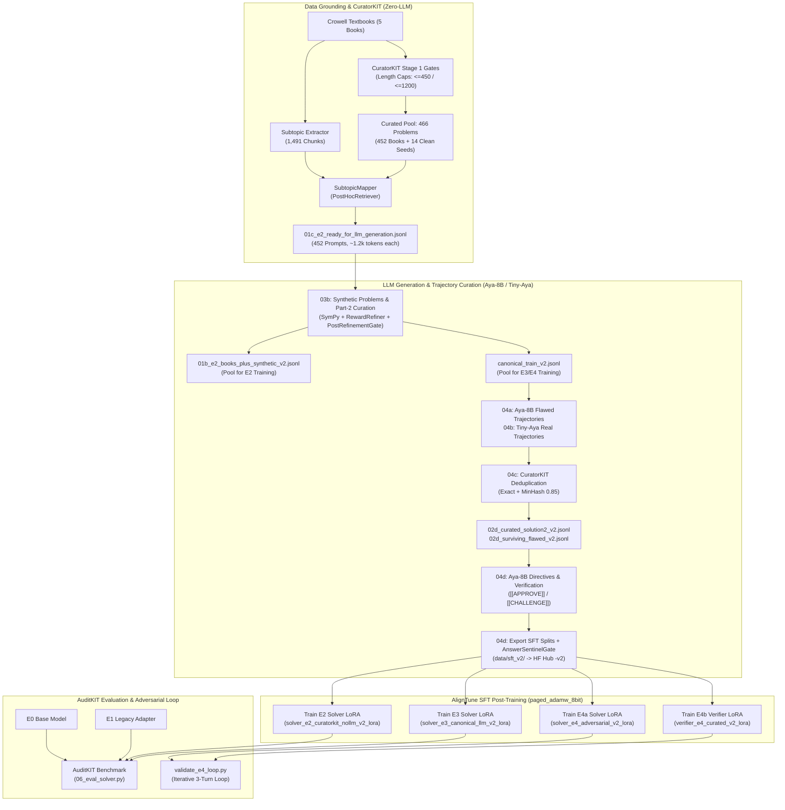

# Adversarial Physics Solver-Verifier: Complete Engineering Blueprint (v2 Architecture)

**Competition:** Lexsi AI Safety & Alignment Hackathon — Track 1, Problem Statement 8 (Data-Scarce Domains)  
**Author:** vital-ar  
**Version:** 2.0 (Post-Diagnostic Comprehensive Blueprint)  
**Repository:** `adversarial_physics_problems_solver`  
**Base Model:** `CohereLabs/tiny-aya-global` (2.8B Parameters)  
**Teacher & Curator Model:** `CohereForAI/aya-expanse-8b`  

---

## 1. Executive Summary & Research Objective

The **Adversarial Physics Solver-Verifier** is a dual-agent collaborative reasoning pipeline designed to solve university-level, multi-step physics problems (1–10 logical steps) within data-scarce domains. It operates through two distinct LoRA adapters fine-tuned on the lightweight `CohereLabs/tiny-aya-global` (2.8B) foundation model:

1. **Model A (Solver LoRA):** Generates structured step-by-step derivations ending with a formal `ANSWER: <expr>` sentinel.
2. **Model B (Verifier LoRA):** Acts as an adversarial critic. It independently audits Model A's derivation without having access to the ground-truth solution, identifies physical or mathematical flaws, produces a targeted, self-contained corrective directive (hint), and emits a final sentinel: `[[APPROVE]]` or `[[CHALLENGE]]`.

At runtime, the agents interact via an iterative feedback loop: if Model B issues `[[CHALLENGE]]`, Model A is reinvoked with the accumulated hints in its prompt (with previous incorrect derivations stripped to avoid context poisoning), attempting up to 3 revision iterations.

### Core Research Question & Lexsi Tool Ablation
The central scientific objective is to benchmark the capabilities of Lexsi AI alignment tools (`CuratorKIT`, `AlignTune`, and `AuditKIT`) in low-resource STEM settings through a progressive 5-experiment ablation matrix:
* **E0 (Base Baseline):** Untouched zero-shot `CohereLabs/tiny-aya-global` evaluated via `AuditKIT`.
* **E1 (Manual Deterministic Rules):** Solver SFT trained on manual heuristic regex filters before `CuratorKIT`.
* **E2 (CuratorKIT Deterministic Gates):** Solver SFT trained on data filtered by `CuratorKIT` (without LLM judges) plus grounded synthetic problem augmentations.
* **E3 (CuratorKIT Full Pipeline + LLM Curation):** Solver SFT trained on the canonical pool curated with `CuratorKIT` and verified by `Aya-8B`.
* **E4a / E4b (Adversarial Solver & Verifier):** Multi-turn hint-conditioned Solver and critique-first Verifier trained via `AlignTune` and evaluated through the iterative loop via `AuditKIT`.

---

## 2. Retrospective on Version 1: The Diagnostic Phase

### 2.1 Why Version 1 Was a Mandatory Stepping Stone (Not a Failure)
In high-stakes, compute-constrained hackathons with small language models (2.8B parameters) operating under tight GPU constraints (2x Nvidia T4 16GB GPUs), theoretical paper designs invariably collide with empirical realities:
* Hardware memory ceilings (CUDA IPC, asymmetric GPU allocations).
* Context window degradations (GPU KV-cache bottlenecks restricting effective sequence lengths to 5.2k tokens).
* Fragility in symbolic code execution on complex multi-part physics problems.

Version 1 served as an indispensable **empirical stress test**. It established the baseline data pipeline, extracted initial raw textbook corpora, and directly probed the failure boundaries of automated curation and evaluation loops. Without Version 1's diagnostics, the architectural optimizations implemented in Version 2 could not have been engineered.

### 2.2 Summary of Accomplishments in Version 1
1. **PhysGym Benchmark Ingestion & Locked Stratification:**
   - Ingested 97 university-level physics problems from `YimengChen/PhysGym` (commit `8e122553897e77495dc2690f16d8055aea1655d7`).
   - Implemented domain-balanced stratified splitting (21 Train Seeds, 38 Validation, 38 Test) across 6 domains: `MECHANICS`, `ELECTROMAGNETISM`, `THERMODYNAMICS`, `OPTICS`, `MODERN_PHYSICS`, and `RELATIVITY` (`configs/data/split_21_38_38.yaml`).
2. **Textbook Corpus Mining:**
   - Ingested five open-source Benjamin Crowell physics textbooks (`lm.pdf`, `me.pdf`, `fac.pdf`, `mod.pdf`, `cp.pdf`) and the master solution manual (`solutions.pdf`).
   - Parsed textbook chapters and matched them to target domains, extracting candidate problem-solution pairs via manual deterministic rules (`data/intermediate/01a_manual_deterministic_only_pool.jsonl`, `1,083` raw records / `951` after CuratorKIT `TextCleaner` + `SchemaGate` + `ExactDeduplicator` in v2).
3. **Initial LoRA Training Run:**
   - Trained the baseline E1 adapter (`models/adapters/solver_e1_manual_det_lora/final_adapter`).
4. **Tooling Integration:**
   - Established initial wrappers for Lexsi `CuratorKIT`, `AlignTune`, and `AuditKIT`.

### 2.3 Bottlenecks & Drawbacks Uncovered in Version 1
With only days remaining before the competition deadline, empirical stress-testing revealed critical bottlenecks:

1. **Heavy Runtime Code Execution & SymPy Parsing:**
   - *Issue:* Version 1 attempted to verify every extracted problem by synthesizing executable Python/SymPy scripts and running them offline in a sandbox.
   - *Drawback:* Multi-part physics problems, differential equations, and problems with custom coordinate systems caused Python timeouts, missing symbolic variable declarations, and syntax failures. This led to high rejection rates of valid physics problems and stalled data generation pipelines.
2. **Step-Count Filtering vs. Token Length Filtering:**
   - *Issue:* Version 1 filtered problems by counting newline "Step N:" markers.
   - *Drawback:* Legitimate, elegant derivations that solved problems in 3 concise equations were filtered out, while verbose, low-information problems with trivial bullet points were admitted. Step counting failed to bound the model's actual sequence length.
3. **Inefficient In-Loop Evaluation Callbacks During AlignTune Training:**
   - *Issue:* Version 1 ran full autoregressive generation and beam search evaluation after every single training epoch.
   - *Drawback:* Evaluating 38 validation problems through full token generation at every epoch hoarded the 262,144-token vocabulary logits in memory, resulting in severe CUDA Out-of-Memory (OOM) errors and multiplying epoch times by 10x.
4. **High Early Stopping Patience & Evaluation Metric Volatility:**
   - *Issue:* Early stopping had a high patience threshold and attempted to evaluate task-accuracy metrics on volatile generations during intermediate epochs.
   - *Drawback:* Models overfit before stopping, wasting hours of GPU time.
5. **Ungrounded Synthetic Data Generation:**
   - *Issue:* Early synthetic attempts tried to generate new problems directly from 21 PhysGym seed prompts without external context.
   - *Drawback:* Small teacher prompts produced hallucinations, repeated the same physical scenarios, and drifted away from authentic physical parameters.
6. **GPU Context Window Bottleneck (5.2k Token Limit):**
   - *Issue:* On 2x T4 GPUs, KV-cache memory pressure degraded performance when prompt contexts exceeded 5,200 tokens.
   - *Drawback:* Concatenating entire book chapters or multi-book passages into prompts caused truncation or out-of-memory errors.

---

## 3. Version 2 Strategic Evolution & Architecture

### 3.1 Core Strategic Shifts
To eliminate these bottlenecks while strictly meeting the competition deadline, Version 2 adopted five fundamental principles:

```
+---------------------------------------------------------------------------------------------------+
|                                  VERSION 2 CORE PRINCIPLES                                        |
+------------------------------------+--------------------------------------------------------------+
| 1. Fast Deterministic Gates        | Replace runtime SymPy execution with CuratorKIT SchemaGate,  |
|                                    | token bounds (<=450 prob, <=1200 sol), & regex hygiene.      |
+------------------------------------+--------------------------------------------------------------+
| 2. Decoupled Training & Eval       | Train via pure NLL loss early stopping (patience=2), then    |
|                                    | select best checkpoint post-training with composite score.   |
+------------------------------------+--------------------------------------------------------------+
| 3. Domain-Grounded Subtopic Chunks | Extract 1,491 chapter-scoped chunks; ground generation with  |
|                                    | exact textbook theory (under 1.5k prompt tokens).            |
+------------------------------------+--------------------------------------------------------------+
| 4. Chapter-Scoped Matching         | Strictly match problems to subtopics from the SAME book and  |
|                                    | chapter using dense embeddings (CuratorKIT PostHocRetriever).|
+------------------------------------+--------------------------------------------------------------+
| 5. Non-Destructive v2 Isolation    | Preserve all v1 assets, checkpoints, and adapters; write all |
|                                    | v2 data and models to *_v2* paths. Reuse E1 adapter directly.|
+------------------------------------+--------------------------------------------------------------+
```

### 3.2 End-to-End System Architecture



---

## 4. In-Depth Tool Selection & Hyperparameter Rationale

### 4.1 CuratorKIT (Data Curation, Hygiene & Provenance)

| Tool / Component | Selected Parameters | Engineering & Scientific Rationale |
| :--- | :--- | :--- |
| **`TextCleaner`** | `fields=["instruction", "output"]` | Normalizes non-standard Unicode characters, unescapes malformed LaTeX syntax (`\frac`, exponents), and standardizes whitespace. |
| **`SchemaGate`** | `min_tokens=25, max_tokens=2048` (Stage 1) / `20`–`8192` (`DatasetExporter`) | Filters empty, truncated, or runaway outputs. Token length bounds are far faster and more robust than counting newline step markers. |
| **`ExactDeduplicator`** | `fields=["instruction", "output"]` | Removes verbatim duplicate samples resulting from cross-edition textbook ingestion and prompt synthesis. |
| **`MinHashDeduplicator`** | `threshold=0.85, num_perm=64` (Trajectories only) | Detects near-duplicate trajectories (e.g., slight rephrasings of the same error). **Intentionally omitted from global multi-turn SFT exports** to avoid collapsing 0-hint, 1-hint, and 2-hint prompt variants of the same problem. |
| **`RewardRefiner` & Post-Gates** | `STAGE1_PHYSICS_REFINE_PROMPT`, `max_tokens=1536`, `PostRefinementGate`, `AnswerSentinelGate` | Re-validates refined Part-2 outputs (and exported Solver rows) for `ANSWER:` sentinels, closed `\left`/`\right` & `$$` delimiters, and zero `"source passage"` meta-leaks before acceptance. |
| **`PostHocRetriever`** | `model="sentence-transformers/all-MiniLM-L6-v2"` | Provides lightweight dense embedding retrieval to score and link problem statements with the most relevant textbook theory chunk within the same chapter. |
| **`ProvenanceManifest`** | `write_checksums=True` | Generates `manifest.json`, `lexsi_provenance.json`, and SHA-256 checksums, fulfilling Lexsi Track 1 requirements for verifiable data lineage. |
| **Strict Diagram Gate** | `regex filters for figure, diagram, photo` | Discards problems dependent on visual diagrams or non-textual references (e.g., "as shown in the figure above"), guaranteeing self-contained textual solvability. |

### 4.2 AlignTune (Supervised Fine-Tuning & Memory Optimization)

| Tool / Parameter | Value | Engineering Rationale |
| :--- | :--- | :--- |
| **Backend** | `TRL` (`create_sft_trainer`) | Native Hugging Face TRL trainer integration optimized for instruction-following causal language models. |
| **Optimizer** | `paged_adamw_8bit` | Automatically pages 32-bit optimizer momentum and variance states between GPU VRAM and CPU system RAM. Keeps optimizer memory overhead below 1.5 GB on T4 GPUs. |
| **Hardware Mapping** | `device_map: "balanced"`, `max_memory: {0: "2.2GiB", 1: "13GiB"}` | **Critical fix for T4 OOM:** PyTorch inherently places input embeddings, forward activations, and the cross-entropy loss computation on GPU 0. By strictly limiting static model weights on GPU 0 to 2.2 GiB (embeddings + first ~6 layers) and allocating remaining layers to GPU 1, GPU 0 retains ample headroom for backpropagation without OOM. |
| **Batch Dynamics** | `effective_batch_size: 16`, `per_device: 1`, `gradient_accumulation: 16` | Ensures stable stochastic gradient descent across batch size 16 without exceeding GPU memory capacity. |
| **LoRA Config** | `r=16, alpha=32, dropout=0.05` | Targets all 7 linear projections (`q_proj`, `k_proj`, `v_proj`, `o_proj`, `gate_proj`, `up_proj`, `down_proj`). Leaves `embed_tokens` and `lm_head` frozen to enable instantaneous zero-latency hot-swapping between Solver and Verifier adapters. |
| **Learning Rates** | `2.0e-4` (Solver) / `1.5e-4` (Verifier) | Tuned for stable convergence on mathematical tokens with `cosine_with_restarts` schedule and 10% warmup. |
| **Loss Masking** | `completion_only_loss: true`, `response_template: "\n\n### Response:\n"` | Masks prompt tokens from the NLL loss calculation, training the model strictly to predict reasoning steps and sentinels. |
| **Early Stopping** | `eval_strategy: "epoch"`, `patience: 2`, `threshold: 0.005`, `metric: "eval_loss"` | Decouples generation from training. Evaluates validation cross-entropy loss rapidly; if loss fails to improve by 0.005 for 2 consecutive epochs, training terminates immediately, preventing overfitting. |
| **Composite Selection** | `alpha * eval_loss - k * accuracy` (`alpha=1.0, k=1.5`) | Runs fast post-training batched validation over saved epoch checkpoints (`checkpoint-*`), selecting the model that optimizes both log-likelihood and answer correctness. |

### 4.3 AuditKIT (Comprehensive Evaluation & Adversarial Benchmarking)

| Metric Suite | Metrics | Purpose & Methodology |
| :--- | :--- | :--- |
| **Suite 1: Deterministic Physical Scorers** | `final_answer_accuracy` ($\pm 1.5\%$) | Extracts the expression after `ANSWER:`. Parses numerical values with 1.5% relative error tolerance and normalizes symbolic LaTeX expressions via SymPy equivalence. |
| **Suite 2: Sentinel & Protocol Compliance** | `verifier_sentinel_accuracy`, `solver_format_accuracy` | Verifies that Model B strictly emits self-contained hints followed by `[[APPROVE]]` or `[[CHALLENGE]]`, and that Model A adheres to the 1–10 step limit. |
| **Suite 3: Verifier Diagnostic Metrics** | `verifier_challenge_precision`, `verifier_approval_recall` | Evaluates whether Model B correctly challenges genuinely flawed derivations without producing false alarms on sound proofs. |
| **Suite 4: Stratified Domain Slices** | `domain_stratified_accuracy` | Evaluates performance across all 6 physics domains separately to detect domain-specific regressions. |
| **Suite 5: Adversarial Loop Dynamics** | `net_revision_gain`, `revision_success_rate` | Measures the percentage of initially failed problems that Model A successfully fixes upon receiving Model B's critique across turns 1 to 3. |

---

## 5. Concrete Data Artifact Inspection & Provenance

To verify dataset integrity before execution, the table below documents one exact entry from each produced JSONL file across the pipeline:

### 5.1 Artifact Summary Table

| File Path | Total Records | Role & Provenance | Key Fields Present |
| :--- | :--- | :--- | :--- |
| `data/splits/train_seeds.jsonl` | 21 | Normalized PhysGym Train Seeds | `problem_id`, `domain`, `problem_statement`, `reference_solution` |
| `data/splits/validation.jsonl` | 38 | Held-out PhysGym Validation Split | `problem_id`, `domain`, `problem_statement`, `reference_solution` |
| `data/splits/test.jsonl` | 38 | Held-out PhysGym Test Split | `problem_id`, `domain`, `problem_statement`, `reference_solution` |
| `data/literature/subtopic_chunks.jsonl` | 1,491 | Chunked Crowell Textbook Sections | `chunk_id`, `book_id`, `chapter`, `section_id`, `section_title`, `text` |
| `data/intermediate/01b_deterministic_curated_pool.jsonl` | 466 | Length-filtered Clean Books + Seeds | `problem_id`, `domain`, `problem_statement`, `reference_solution`, `source` |
| `data/intermediate/01c_e2_ready_for_llm_generation.jsonl` | 452 | Grounded LLM Generation Prompts | `anchor_problem_id`, `domain`, `matched_subtopic`, `matched_seed_id`, `user_prompt` |

### 5.2 Deep-Dive: How Problems Are Chained With Correct Book Chunks

A central innovation in Version 2 is the **Chapter-Scoped Grounding Mechanism** implemented in `SubtopicMapper` (`src/adversarial_physics/data/ingestion/subtopic_extractor.py`):

1. **Chapter Scoping (Zero Cross-Mixing):**
   - Each textbook problem retains its metadata origin (e.g., `crowell_conceptual_physics:05_electricity:p001`).
   - The extractor parses `book_id="crowell_conceptual_physics"` and `chapter_slug="05_electricity"`.
   - The retrieval candidates are restricted *strictly* to the subtopic chunks originating from that exact book and chapter. Chunks from different books or different chapters in the same domain are never mixed.
2. **Dense Semantic Matching via CuratorKIT `PostHocRetriever`:**
   - Within the filtered chapter chunks, the problem statement and the first 400 characters of its solution are encoded using `sentence-transformers/all-MiniLM-L6-v2`.
   - Cosine similarity is computed against each section's header and body text (`section_id + section_title + text`).
   - The top-1 chunk (`matched_subtopic`) is selected. For example, problem `p001` (dealing with muon orbit and electric force) was matched with section `5.1`: *"The quest for the atomic force"*.
3. **Prompt Synthesis:**
   - The prompt builder (`synthetic_problem_generator.py`) pairs the anchor textbook problem with:
     a) The grounded `matched_subtopic` snippet.
     b) A style exemplar seed from the same domain (`physgym_0010`).
   - The resulting prompt instructs the teacher LLM to transform the problem into formal LaTeX grounded in the provided theory snippet, fitting comfortably within ~1,231 tokens (well below the 5.2k GPU limit).

---

## 6. Execution Roadmap & Verification Commands

All v2 operations are partitioned into clean, self-contained stages that operate purely on `*_v2*` paths:

```bash
# ---------------------------------------------------------
# Phase A: Score Baselines (E0 Base Model & Legacy E1 Adapter)
# Note: On Kaggle/fresh clones (`*.safetensors` is gitignored), pass the HF Hub adapter ID for E1.
# ---------------------------------------------------------
python scripts/01_ingest_and_split.py --config configs/data/ingestion.yaml
python scripts/06_eval_solver.py --experiment E0_base_tiny_aya_v2 --base-model CohereLabs/tiny-aya-global --chat-template --output-dir results/eval_e0_v2
python scripts/06_eval_solver.py --experiment E1_solver_manual_det_v2 --base-model CohereLabs/tiny-aya-global --adapter-dir vital-ar/adversarial-physics-solver-e1-manual-det-lora --output-dir results/eval_e1_v2

# ---------------------------------------------------------
# Phase B: Synthetic Data & SFT Dataset Export (v2)
# ---------------------------------------------------------
python scripts/03b_generate_synthetic_e2.py --backend hf_gpu --clean-books data/intermediate/01b_deterministic_curated_pool.jsonl --subtopics data/literature/subtopic_chunks.jsonl --checkpoint data/synthetic/03b_e2_synthetic_checkpoint_v2.jsonl --synthetic-out data/synthetic/03b_e2_synthetic_raw_v2.jsonl --e2-out data/intermediate/01b_e2_books_plus_synthetic_v2.jsonl --e3-out data/processed/canonical_train_v2.jsonl --summary-out data/synthetic/03b_e2_synthetic_summary_v2.json
python scripts/04a_generate_aya8b_trajectories.py --step both --canonical-train data/processed/canonical_train_v2.jsonl --sol2-checkpoint data/synthetic/02a_aya8b_solution2_checkpoint_v2.jsonl --sol2-output data/synthetic/02a_aya8b_solution2_raw_v2.jsonl --flawed-checkpoint data/synthetic/02b_aya8b_flawed_checkpoint_v2.jsonl --flawed-output data/synthetic/02b_aya8b_flawed_raw_v2.jsonl
python scripts/04b_harvest_tiny_aya_failures.py --canonical-train data/processed/canonical_train_v2.jsonl --checkpoint data/synthetic/02c_tiny_aya_failures_checkpoint_v2.jsonl --output data/synthetic/02c_tiny_aya_failures_raw_v2.jsonl
python scripts/04c_curatorkit_dedup_trajectories.py --canonical-train data/processed/canonical_train_v2.jsonl --sol2-input data/synthetic/02a_aya8b_solution2_raw_v2.jsonl --flawed-8b-input data/synthetic/02b_aya8b_flawed_raw_v2.jsonl --tiny-aya-input data/synthetic/02c_tiny_aya_failures_raw_v2.jsonl --raw-synthetic-output data/synthetic/02_raw_synthetic_pool_v2.jsonl --curated-sol2-output data/synthetic/02d_curated_solution2_v2.jsonl --tiny-aya-correct-output data/synthetic/02d_tiny_aya_correct_curated_v2.jsonl --surviving-flawed-output data/synthetic/02d_surviving_flawed_v2.jsonl --rejected-output data/synthetic/02d_rejected_trajectories_v2.jsonl --summary-output data/synthetic/02d_curation_summary_v2.json
python scripts/04d_generate_aya8b_directives_and_export.py --canonical-train data/processed/canonical_train_v2.jsonl --e2-pool data/intermediate/01b_e2_books_plus_synthetic_v2.jsonl --curated-sol2 data/synthetic/02d_curated_solution2_v2.jsonl --surviving-flawed data/synthetic/02d_surviving_flawed_v2.jsonl --directives-checkpoint data/synthetic/02e_aya8b_directives_checkpoint_v2.jsonl --directives-output data/synthetic/02e_aya8b_directives_curated_v2.jsonl --sft-output-root data/sft_v2

# Publish data/sft_v2/* to Hugging Face Hub before Kaggle Phase C runs (`/data/` is gitignored)
hf upload vital-ar/physics-solver-e1-manual-rules-v2     data/sft_v2/solver_e1_manual_det     . --repo-type dataset
hf upload vital-ar/physics-solver-e2-curatorkit-nollm-v2 data/sft_v2/solver_e2_curatorkit_nollm . --repo-type dataset
hf upload vital-ar/physics-solver-e3-canonical-llm-v2    data/sft_v2/solver_e3_canonical_llm    . --repo-type dataset
hf upload vital-ar/physics-solver-e4-adversarial-v2      data/sft_v2/solver_e4_adversarial      . --repo-type dataset
hf upload vital-ar/physics-verifier-e4-curated-v2        data/sft_v2/verifier_e4_curated        . --repo-type dataset

# ---------------------------------------------------------
# Phase C: Train AlignTune LoRA Models (E2, E3, E4a, E4b)
# Run distinct `--dataset` recipes across concurrent Kaggle notebooks so `--push-to-hub` targets unique repos.
# ---------------------------------------------------------
python scripts/05_train_aligntune.py --dataset solver_e2_curatorkit_nollm --config configs/training/aligntune_training_v2.yaml --output-dir models/adapters/solver_e2_curatorkit_nollm_v2_lora --push-to-hub
python scripts/05_train_aligntune.py --dataset solver_e3_canonical_llm --config configs/training/aligntune_training_v2.yaml --output-dir models/adapters/solver_e3_canonical_llm_v2_lora --push-to-hub
python scripts/05_train_aligntune.py --dataset solver_e4_adversarial --config configs/training/aligntune_training_v2.yaml --output-dir models/adapters/solver_e4_adversarial_v2_lora --push-to-hub
python scripts/05_train_aligntune.py --dataset verifier_e4_curated --config configs/training/aligntune_training_v2.yaml --output-dir models/adapters/verifier_e4_curated_v2_lora --push-to-hub

# ---------------------------------------------------------
# Phase D: Evaluate Adapters & Run Iterative Validation Loop
# ---------------------------------------------------------
python scripts/06_eval_solver.py --experiment E2_solver_curatorkit_nollm_v2 --base-model CohereLabs/tiny-aya-global --adapter-dir vital-ar/adversarial-physics-solver-e2-curatorkit-nollm-v2-lora --output-dir results/eval_e2_v2
python scripts/06_eval_solver.py --experiment E3_solver_canonical_llm_v2 --base-model CohereLabs/tiny-aya-global --adapter-dir vital-ar/adversarial-physics-solver-e3-canonical-llm-v2-lora --output-dir results/eval_e3_v2
python scripts/06_eval_solver.py --experiment E4a_solver_adversarial_v2 --base-model CohereLabs/tiny-aya-global --adapter-dir vital-ar/adversarial-physics-solver-e4-adversarial-v2-lora --output-dir results/eval_e4a_v2
python scripts/validate_e4_loop.py --base-model CohereLabs/tiny-aya-global --solver-adapter vital-ar/adversarial-physics-solver-e4-adversarial-v2-lora --verifier-adapter vital-ar/adversarial-physics-verifier-e4-curated-v2-lora --validation-path data/splits/validation.jsonl --output-dir outputs/validation/e4_loop_val_v2
python scripts/validate_e4_loop.py --base-model CohereLabs/tiny-aya-global --solver-adapter vital-ar/adversarial-physics-solver-e4-adversarial-v2-lora --verifier-adapter vital-ar/adversarial-physics-verifier-e4-curated-v2-lora --validation-path data/splits/test.jsonl --output-dir outputs/validation/e4_loop_test_v2
```
